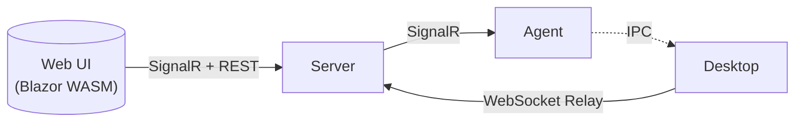
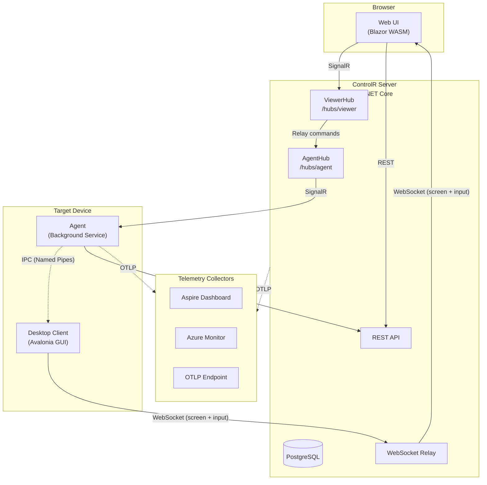

## Architecture

ControlR follows a hub-and-spoke architecture with the server acting as the central control plane. Communication is split across three transports: **SignalR** for real-time command and status, **REST** for resource operations, and **WebSockets** for high-bandwidth remote control streaming.

### High-Level Flow



### Detailed Architecture



### How the Pieces Fit Together

| Component | Talks To | Transport | Purpose |
|-----------|----------|-----------|---------|
| **Web UI** | Server | SignalR (ViewerHub) | Send commands, receive device updates & streaming data |
| **Web UI** | Server | REST | CRUD operations on devices, users, settings, etc. |
| **Web UI** | Server | WebSocket (Relay) | Receive remote control screen frames, send input events |
| **Agent** | Server | SignalR (AgentHub) | Register device, receive commands, send heartbeats & status |
| **Agent** | Server | REST | Device registration and configuration |
| **Agent** | Desktop Client | IPC (Named Pipes) | Delegate OS-level operations: screen capture, input, permissions |
| **Desktop Client** | Server | WebSocket (Relay) | Stream screen captures, receive remote input events |

---

## Server Component

**Projects:** `ControlR.Web.Server`, `ControlR.Web.Client`

The server is an ASP.NET Core application that orchestrates all ControlR communication. It hosts the web UI (Blazor WASM), both SignalR hubs, the REST API, and the built-in WebSocket relay.

| Responsibility | Technology |
|---------------|------------|
| **Web UI hosting** | Blazor WASM (served as static assets) |
| **REST API** | ASP.NET Core controllers |
| **Real-time commands** | SignalR with MessagePack protocol |
| **Remote control streaming** | Built-in WebSocket relay |
| **Authentication** | ASP.NET Core Identity with dynamic policy scheme |
| **Authorization** | Role-based + resource-based (tags) |
| **Data persistence** | EF Core with PostgreSQL |
| **API documentation** | Scalar / OpenAPI |
| **Telemetry** | OpenTelemetry (OTLP export) |

The server runs as a Docker container (default port 5120) and can also be deployed natively.

### Authentication Pipeline

The server supports four authentication schemes routed through a dynamic policy scheme:

| Scheme | Mechanism | Use Case |
|--------|-----------|----------|
| **Identity Cookie** | Standard cookie auth | Web UI (Blazor WASM) |
| **Logon Token** | Query-string parameter | Device access URLs |
| **Bearer Token** | `Authorization: Bearer` header | API clients, ASP.NET Core Identity tokens |
| **Personal Access Token** | `x-personal-token` header | Automation, CI/CD, headless access |

### SignalR Hubs

| Hub | Endpoint | Connected By | Purpose |
|-----|----------|-------------|---------|
| **AgentHub** | `/hubs/agent` | Agent | Device registration, command dispatch, heartbeat, status updates |
| **ViewerHub** | `/hubs/viewer` | Web UI | User-initiated commands: remote control requests, terminal input, file operations |

The hubs relay messages between each other. For example, when a viewer sends a terminal command via `ViewerHub`, the server forwards it to the target device through `AgentHub`. The agent's response flows back the same path.

### WebSocket Relay

The WebSocket relay is now **built into the main server** (it was previously a separately deployable service). It handles the high-bandwidth streaming path for remote control:

- **Responder** role: the Desktop Client on the target device, which captures and sends screen frames
- **Requester** role: the Web UI (browser), which receives frames and sends input events

Sessions are established via SignalR (ViewerHub → AgentHub) and then handed off to the WebSocket relay for the streaming phase. This bypasses SignalR's overhead for the continuous frame stream while still using SignalR for session setup, teardown, and metadata.

---

## Agent Component

**Projects:** `ControlR.Agent`, `ControlR.Agent.Shared`, `ControlR.Agent.Common`

The agent runs as a background service on each managed device. It is the bridge between the server and the local device, providing background-accessible tools and coordinating with the Desktop Client for GUI-dependent operations.

### Capabilities

| Capability | Description | Requires Desktop Client? |
|------------|-------------|:---:|
| **Terminal** | Cross-platform PowerShell sessions over SignalR | No |
| **File System** | Browse, upload, and download files on the device | No |
| **Chat** | Real-time messaging between viewer and device user | Yes (for GUI notifications) |
| **Log Streaming** | Stream log files from the device to viewers | No |
| **Remote Control** | Coordinated via IPC with Desktop Client | **Yes** |
| **Auto Update** | Periodically checks for and applies agent updates | No |

### Relationship with Desktop Client

The agent does **not** render the screen or capture input directly. Instead, it delegates these OS-level GUI operations to the Desktop Client through **IPC (named pipes)** using the [StreamJsonRpc](https://github.com/microsoft/vs-streamjsonrpc) protocol:

- The agent hosts an **IPC server** (named pipe) on the local machine.
- The Desktop Client connects as an **IPC client** and exposes an `IDesktopClientRpcService` interface.
- The agent calls methods like `ReceiveRemoteControlRequest`, `GetDesktopPreview`, and `InvokeCtrlAltDel` over IPC.
- The Desktop Client calls back to the agent (via `IAgentRpcService`) for chat message delivery.

This separation keeps the agent lightweight and allows it to run headlessly, while the Desktop Client handles GUI-specific work.

### Platform Support

| Platform | Remote Control | Terminal | Auto-Update |
|----------|:---:|:---:|:---:|
| Windows 11 (x64, x86) | Full | Yes | Yes |
| macOS Apple Silicon (M1+) | Full | Yes | Yes |
| Linux AMD64 (X11) | Full | Yes | Yes |
| Linux (Wayland) | Experimental | Yes | Yes |
| macOS (VNC fallback) | Experimental | Yes | Yes |

---

## Desktop Client

**Projects:** `ControlR.DesktopClient`, `ControlR.DesktopClient.Common`, `ControlR.DesktopClient.{Windows,Linux,Mac}`

The Desktop Client is an [Avalonia UI](https://avaloniaui.net/) cross-platform desktop application that runs alongside the agent on managed devices. It provides:

- **Screen capture & input forwarding**: The actual work of capturing the desktop and injecting mouse/keyboard events during remote control sessions
- **Live session visibility**: Shows the local user when a remote session is active
- **Session consent & notifications**: Prompts the local user before granting remote access
- **WebSocket relay streaming**: Connects directly to the server's WebSocket relay to send screen frames and receive input from the viewer

### Communication Paths

```
Agent ←——IPC (Named Pipes)——→ Desktop Client
Desktop Client ——WebSocket Relay——→ Server ←——WebSocket Relay——→ Web UI
```

The Desktop Client connects to the server's WebSocket relay **only during active remote control sessions**. Session setup is initiated by the agent over IPC, and once established, the Desktop Client streams screen captures and receives input events through the relay.

---

## Database

**Technology:** PostgreSQL via Entity Framework Core

**Key entities:**

| Entity | Description |
|--------|-------------|
| Devices | Registered agents with status, platform info, and connection state |
| Users | ASP.NET Core Identity accounts with roles |
| Tenants | Multi-tenant isolation (if enabled) |
| Installer Keys | Pre-shared keys for agent installation authorization |
| Personal Access Tokens | Headless API access tokens |
| Invitations | User invitation codes |
| Tags | Device grouping and resource-based authorization |

---

## Telemetry

Both the **Server** and the **Agent** can optionally export OpenTelemetry data (traces, metrics, logs) to any OTLP-compatible collector:

| Environment | Collector | Configuration |
|-------------|-----------|---------------|
| Development | ASP.NET Aspire Dashboard | Set `OTLP_ENDPOINT_URL` to the Aspire OTLP endpoint |
| Production | Azure Monitor | Set `AzureMonitor:ConnectionString` |
| Production (alt) | Any OTLP-compatible backend | Set `OTLP_ENDPOINT_URL` to your collector |

---

## End-to-End Flow: Remote Control Session

1. **Viewer** (browser) requests remote control on a device via `ViewerHub` (SignalR)
2. **Server** forwards the request to the target **Agent** via `AgentHub` (SignalR)
3. **Agent** sends a remote control request to the **Desktop Client** over IPC
4. **Desktop Client** prompts the local user for consent (if configured)
5. Upon consent, the Desktop Client connects to the server's **WebSocket relay** as a `Responder`
6. The **Viewer** connects to the **WebSocket relay** as a `Requester`
7. The relay bridges WebSocket frames: screen captures from Desktop Client → Viewer, input events from Viewer → Desktop Client
8. SignalR handles session teardown: either side can request disconnect through the normal hub path

## Next

- **[Getting Started](/docs/getting-started)**: Overview and quick start
- **[Configuration](/docs/configuration)**: Configuration options
