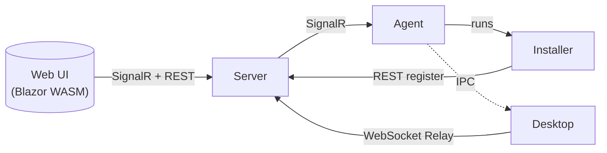
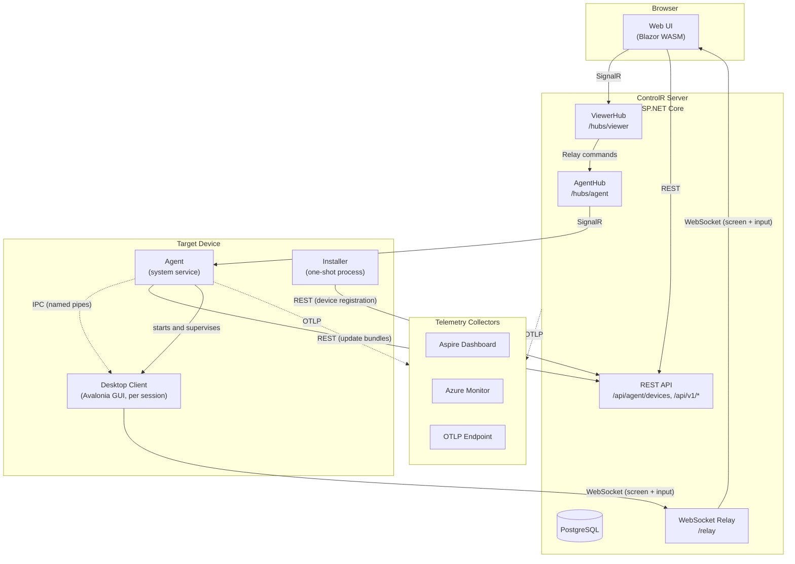

ControlR follows a hub-and-spoke architecture with the server acting as the central control plane. Communication is split across three transports: **SignalR** for real-time command and status, **REST** for resource operations plus agent installation and updates, and **WebSockets** for high-bandwidth remote control streaming.

## High-Level Flow



## Detailed Architecture



## How the Pieces Fit Together

| Component | Talks To | Transport | Purpose |
|-----------|----------|-----------|---------|
| **Web UI** | Server | SignalR (ViewerHub) | Send commands, receive device updates & streaming data |
| **Web UI** | Server | REST | CRUD operations on devices, users, settings, etc. |
| **Web UI** | Server | WebSocket (Relay) | Receive remote control screen frames, send input events |
| **Agent** | Server | SignalR (AgentHub) | Command handling, signed device status updates (heartbeat), streamed file and terminal payloads |
| **Installer** | Server | REST | Device registration (`POST /api/agent/devices`) and update-bundle download |
| **Agent** | Server | REST | Fetch update-bundle metadata, download update bundles |
| **Agent** | Desktop Client | IPC (named pipes) | Delegate OS-level GUI operations: screen capture, input, permissions |
| **Desktop Client** | Server | WebSocket (Relay) | Stream screen captures, receive remote input events |

Device registration is the one place where the two agent-side transports meet. The installer creates the device row over REST, and the running agent keeps that row fresh over SignalR.

---

## Server Component

**Projects:** `ControlR.Web.Server`, `ControlR.Web.Client`, `ControlR.ApiClient`, `ControlR.Web.ServiceDefaults`

The server is an ASP.NET Core application that orchestrates all ControlR communication. It hosts the web UI, both SignalR hubs, the REST API, and the built-in WebSocket relay.

The UI is a Blazor Web App. Interactive components run in WebAssembly render mode from `ControlR.Web.Client`, and the identity pages (login, passkey sign-in, external-login callbacks, account management) are server-side Razor components in `ControlR.Web.Server`.

| Responsibility | Technology |
|---------------|------------|
| **Web UI hosting** | Blazor Web App, interactive WebAssembly render mode |
| **REST API** | ASP.NET Core controllers |
| **Real-time commands** | SignalR. The server registers both MessagePack and JSON. The shipped clients add only JSON, so hub traffic on the wire is JSON |
| **Remote control streaming** | Built-in WebSocket relay |
| **Authentication** | ASP.NET Core Identity with a dynamic policy scheme |
| **Authorization** | Fine-grained, scope-based permission assignments |
| **Data persistence** | EF Core with PostgreSQL (`ControlR_AppOptions__UseInMemoryDatabase` switches to an in-memory store for development) |
| **API documentation** | Scalar / OpenAPI |
| **Telemetry** | OpenTelemetry (OTLP export) |

`ControlR.ApiClient` is the typed REST SDK. The agent, the installer, and the browser client all reach the server through it. `ControlR.Web.ServiceDefaults` holds the shared health-check and OpenTelemetry wiring used by both the server and the agent.

The container listens on port 8080 through `ASPNETCORE_HTTP_PORTS`, and the image also exposes 8081. The shipped compose file maps host port 5120 to container port 8080, and `launchSettings.json` binds `http://localhost:5120` for local runs, so 5120 is the usual browser-facing port.

### Authentication Pipeline

The server routes every request through one policy scheme, `CustomSchemes.Dynamic`, which forwards to a handler. Evaluation is ordered, and the first match wins:

| Order | Detected signal | Handler | Condition |
|-------|-----------------|---------|-----------|
| 1 | `logonToken` plus `deviceId` query parameters on a path starting with `/device-access` | Logon Token | Always available |
| 2 | `Authorization: Bearer` header | Interactive Bearer | Only when `ControlR_AppOptions__EnableInteractiveBearerLogin` is `true` |
| 3 | `x-personal-token` header | Personal Access Token | Always available |
| 4 | `x-api-key` header | Service Account Credential | Always available |
| 5 | Anything else | Identity Cookie | Always available |

Because the machine-to-machine credentials are read from dedicated headers, a credential sent in the wrong header is not recognized. It falls through to the cookie scheme and the request is rejected with 401.

| Scheme | Mechanism | Use Case |
|--------|-----------|----------|
| **Identity Cookie** | Standard cookie auth | Web UI (Blazor Web App) |
| **Logon Token** | Query-string parameter, paired with a device ID | Device access URLs for ad-hoc browser sessions |
| **Bearer Token** | `Authorization: Bearer` header | Interactive sign-in from API clients, behind a config flag |
| **Personal Access Token** | `x-personal-token` header | Automation, CI/CD, headless access as a specific user |
| **Service Account Credential** | `x-api-key` header | Non-interactive automation. Both server-kind and tenant-kind accounts use this header. A tenant-kind account is confined to its own tenant |

### SignalR Hubs

| Hub | Endpoint | Connected By | Purpose |
|-----|----------|-------------|---------|
| **AgentHub** | `/hubs/agent` | Agent | Command dispatch, signed device status updates, heartbeat, streamed payloads |
| **ViewerHub** | `/hubs/viewer` | Web UI | User-initiated commands: remote control requests, terminal input, file operations |

The hubs relay messages between each other. When a viewer sends a terminal command via `ViewerHub`, the server invokes the matching method on the target agent's `AgentHub` connection. The agent's response flows back the same path.

The two sides prove their identity differently. ViewerHub connections carry an ordinary authenticated user principal. AgentHub connections are not authenticated by an ASP.NET Core scheme. Each agent holds an Ed25519 key pair generated at install time, and its device status updates are sent as `UpdateDeviceSigned`, which the server verifies against the public key stored during registration. An unknown device is rejected unless `ControlR_AppOptions__AllowAgentsToSelfBootstrap` is enabled, and self-bootstrap is only accepted on a server that has exactly one tenant.

### WebSocket Relay

The WebSocket relay is hosted in the main server at `/relay`. A standalone host project, `ControlR.Web.WebSocketRelay`, still exists in the repository and builds on its own, but it is not part of the shipped compose stack.

The relay pairs exactly two sockets per session and forwards bytes between them. When one side closes, the relay closes its partner. Sessions are matched by a session ID in the query string, and the connection carries a `role` parameter:

- **Responder** role: the side that supplies the screen. During remote control this is the Desktop Client on the target device. For the VNC relay it is the agent, which pipes the socket to a loopback VNC server.
- **Requester** role: the side that views and sends input. This is the browser, or the standalone `ControlR.Viewer.Avalonia` app.

The main server requires the requester to be an authenticated principal. The standalone host maps the same middleware with default options, which do not require that. Screen frames travel as MessagePack-serialized payloads over the relay socket, which is separate from the JSON used on the hubs.

---

## Agent Component

**Projects:** `ControlR.Agent`, `ControlR.Agent.Common`, `ControlR.Agent.Shared`, `ControlR.Agent.Installer`

The agent runs as one background service per machine (per instance ID). It is the bridge between the server and the local device, and it supervises the Desktop Client.

### Process Model

- **Agent.** A single system-level process. Windows service `ControlR.Agent`, systemd unit `controlr.agent.service`, or a launchd daemon whose label is prefixed with `app.controlr`.
- **Desktop Client.** A separate process per interactive user session, launched and supervised by the agent rather than by the installer. On Windows the agent launches the binary into each active session. On Linux it drives a per-user systemd user service, and on macOS a per-user LaunchAgent.
- **Installer.** A separate `ControlR.Agent.Installer` executable with `install`, `uninstall`, and `repair-desktop` commands. The agent invokes it for self-update and desktop-client repair. On macOS it runs briefly as a one-shot launchd daemon.

### Capabilities

| Capability | Description | Requires Desktop Client? |
|------------|-------------|:---:|
| **Terminal** | Embedded PowerShell sessions over SignalR | No |
| **File System** | Browse, upload, and download files on the device | No |
| **Chat** | Real-time messaging between viewer and device user | Yes. Messages are delivered to the Desktop Client over IPC |
| **Log Streaming** | Stream log files from the device to viewers | No |
| **Remote Control** | Coordinated via IPC with the Desktop Client | **Yes** |
| **VNC Relay** | Proxy a loopback VNC server to the server relay | No |
| **Auto Update** | Periodically checks for and applies agent updates | No |

### Relationship with Desktop Client

The agent does **not** render the screen or capture input directly. It delegates these OS-level GUI operations to the Desktop Client through **IPC (named pipes)** using the [StreamJsonRpc](https://github.com/microsoft/vs-streamjsonrpc) protocol with a MessagePack formatter:

- The agent hosts the **IPC server**. The pipe name is `controlr-ipc-server`, with the instance ID appended when one is set. Named pipes are used on every platform. On Linux and macOS the pipe name is a `/tmp` path.
- The Desktop Client connects as the **IPC client** and exposes `IDesktopClientRpcService`.
- The agent calls methods such as `ReceiveRemoteControlRequest`, `GetDesktopPreview`, and `InvokeCtrlAltDel` on that interface.
- The connection is duplex. The Desktop Client calls back on `IAgentRpcService`, which exposes `SendChatResponse` for the device user's reply. Chat messages sent *to* the device arrive on `IDesktopClientRpcService.ReceiveChatMessage`.

This separation keeps the agent lightweight and allows it to run headlessly, while the Desktop Client handles GUI-specific work.

### Platform Support

| Platform | Remote Control | Terminal | Auto-Update | Chat | File System |
|----------|:---:|:---:|:---:|:---:|:---:|
| Windows 11 (x64, x86) | Full | Yes | Yes | Yes | Yes |
| macOS Apple Silicon (M1+) | Full¹ | Yes | Yes | Yes | Yes |
| macOS Intel | Untested | Yes | Yes | Yes | Yes |
| Linux AMD64 (X11) | Full | Yes | Yes | Yes | Yes |
| Linux (Wayland) | Experimental² | Yes | Yes | Yes | Yes |
| macOS (Apple Screen Sharing / VNC) | Experimental | Yes | Yes | Yes | Yes |

¹ Controlling the macOS login window requires an already-logged-in user session.
² Requires the XDG Desktop Portal with a restore token cached for the user. See the user guide for setup details.

---

## Desktop Client

**Projects:** `ControlR.DesktopClient`, `ControlR.DesktopClient.Common`, `ControlR.DesktopClient.Windows`, `ControlR.DesktopClient.Linux`, `ControlR.DesktopClient.Mac`

The Desktop Client is an [Avalonia UI](https://avaloniaui.net/) cross-platform desktop application that runs per interactive session on managed devices. It provides:

- **Screen capture & input forwarding**: the actual work of capturing the desktop and injecting mouse/keyboard events during remote control sessions
- **Live session visibility**: shows the local user when a remote session is active
- **Session consent & notifications**: prompts the local user before granting remote access
- **WebSocket relay streaming**: opens the relay socket to send screen frames and receive input from the viewer

The Desktop Client has no SignalR connection. It reaches the server only through the relay socket, and it reaches the agent only through IPC.

### Communication Paths

```
Agent <--- IPC (Named Pipes) ---> Desktop Client
Desktop Client --- WebSocket Relay ---> Server <--- WebSocket Relay --- Web UI
```

The viewer's browser builds the relay URI for the responder and hands it to the server over `ViewerHub`. The server forwards it to the agent on `AgentHub`, and the agent passes it to the Desktop Client in the remote control request over IPC. The Desktop Client then opens the socket itself, as the `responder` role. It connects **only during active remote control sessions**.

---

## Database

**Technology:** PostgreSQL via Entity Framework Core

**Key entities:**

| Entity | Description |
|--------|-------------|
| Devices | Registered agents with status, platform info, and connection state |
| Users | ASP.NET Core Identity accounts, each in one tenant |
| Tenants | Multi-tenant isolation boundary |
| Customers | Named grouping of devices inside a tenant |
| Installer Keys | Pre-shared keys that authorize agent installation |
| Personal Access Tokens | Headless API access tokens, with their own permission mode |
| Service Accounts and Credentials | Non-interactive principals, server-kind or tenant-kind, plus their API keys |
| Logon Tokens | Single-use, device-scoped browser session grants |
| Permission Assignments | The allow and deny rules that replace fixed roles |
| User Groups and Device Groups | Principals that can hold grants, and device collections that can be scoped |
| Tenant Settings | Per-tenant configuration rows |
| Tenant Invitations | Activation codes for joining an existing tenant |
| Authorization Change Logs | Audit trail of permission changes |
| Server Alerts | A single server-wide banner shown to signed-in users |
| Tags | Device labels used for grouping and filtering. Tags grant no access |

---

## Telemetry

The **Server** and the **Agent** can optionally export OpenTelemetry data (traces, metrics, logs). The Desktop Client does not export telemetry. It writes Serilog files. Two destinations are independent and may both be configured:

| Destination | Configuration |
|---|---|
| ASP.NET Aspire Dashboard (development) | Point an OTLP endpoint variable at the Aspire OTLP endpoint |
| Any OTLP-compatible backend | Point an OTLP endpoint variable at your collector |
| Azure Monitor / Application Insights | Set `AzureMonitor__ConnectionString` |

For the OTLP destination, `OTEL_EXPORTER_OTLP_ENDPOINT` is read first and wins when both are set. `OTLP_ENDPOINT_URL` is the fallback that the shipped compose file uses. Environment variables reach server configuration both unprefixed and with a `ControlR_` prefix, so `ControlR_OTLP_ENDPOINT_URL` also works there. The agent reads its configuration without a prefix, so it uses the unprefixed names.

---

## End-to-End Flow: Remote Control Session

1. **Viewer** (browser) requests remote control on a device via `ViewerHub` (SignalR)
2. **Viewer** builds the relay URI for the responder and sends it with the request
3. **Server** forwards the request, including that URI, to the target **Agent** via `AgentHub` (SignalR)
4. **Agent** forwards the request and the URI to the **Desktop Client** over IPC
5. **Desktop Client** prompts the local user for consent (if configured)
6. On consent, the Desktop Client connects to the server's **WebSocket relay** as the `responder`
7. The **Viewer** connects to the **WebSocket relay** as the `requester`
8. The relay bridges WebSocket frames: screen captures from Desktop Client to Viewer, input events from Viewer to Desktop Client
9. When either socket closes, the relay closes its partner. SignalR remains the channel for device state and for the next command

## Next

- **[Getting Started](/docs/getting-started)**: Overview and quick start
- **[Configuration](/docs/configuration)**: Configuration options
