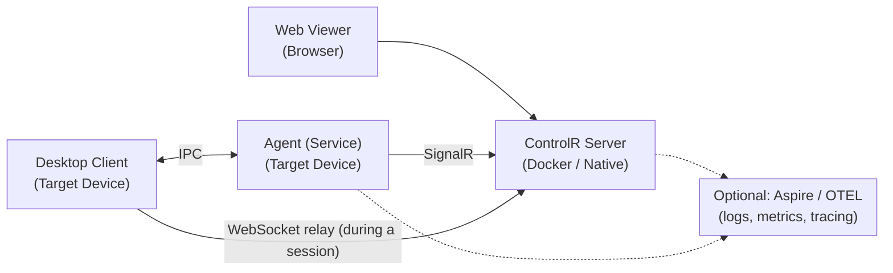

## What is ControlR?

ControlR is a self-hosted remote control system with three components:

- **Server**: An ASP.NET Core application (Docker container or native Linux process) that owns authentication, the device registry, SignalR hubs, the versioned V1 REST API, and the built-in WebSocket relay that carries screen streaming.
- **Agent**: A background service installed on each device you want to manage. It runs on Windows, macOS, and Linux. It provides terminal, chat, file system access, log streaming, and self-update, and it coordinates remote control sessions.
- **Desktop Client**: An Avalonia GUI process the agent launches in each active user session. Performs the actual screen capture and input injection. It notifies the local user with a toast when a remote session starts and ends.

## Core Concepts

### Server

The server hosts:

- Connected agents and their status
- Authentication and authorization (Identity, cookie, bearer, PAT, service account, logon token)
- SignalR hubs for real-time commands
- A WebSocket relay for screen streaming
- Telemetry export (OpenTelemetry / Azure Monitor)

### Agent

Each device you want to manage runs an agent. The agent:

- Registers the device with the server at install time. The installer authenticates the registration with an installer key you create in the web UI, so registration is key-gated by default
- Self-registers without a key only when the server enables `AllowAgentsToSelfBootstrap`. That path is accepted only on single-tenant servers, at agent connection time. Deploy-page installs always carry a key
- Maintains an outbound-only SignalR connection (WebSocket) to the server
- Provides terminal, chat, file system access, log streaming, and auto-update
- Runs as `SYSTEM` (Windows service), `root` (Linux systemd, macOS launchd)
- Spawns a per-session Desktop Client process for GUI capture and input forwarding

### Desktop Client

The desktop client runs on the target device and:

- Captures the screen and injects mouse/keyboard for remote control sessions
- Shows the local user a toast notification when a remote session starts and ends
- Connects to the server's WebSocket relay once a session is established (not before)

### Component Diagram

## Prerequisites

Before installing:

- For the Docker Compose deployment: **Docker** and **Docker Compose** on the host running the server. For the native deployment: Linux (AMD64 or ARM64) and PostgreSQL 18. See [Native Installation](/docs/admin/native-installation).
- A reachable domain name if you plan to terminate TLS in front of the server (recommended).
- At least 1 GB of RAM available for the server.
- An installer key for each device you install, created from the Deploy page or the Installer Keys page after the server is running. The agent installer uses it to register the device.
- The bundled Compose stack maps host port `5120` to container port `8080`. Change the host port in the Compose file's port mapping. Leave `ASPNETCORE_HTTP_PORTS` set to `8080` inside the container. That variable changes the port the app listens on inside the container, not the host port.

## Next Steps

1. **[Installation](/docs/installation)**: Deploy ControlR via Docker Compose or native install.
2. **[Configuration](/docs/configuration)**: Tune `AppOptions` and related settings.
3. **[Reverse Proxy](/docs/admin/reverse-proxy)**: Put HTTPS in front of the server.

## Need Help?

- Join the [Discord community](https://discord.gg/JWJmMPc72H).
- Search or start a [GitHub Discussion](https://github.com/bitbound/ControlR/discussions).
- File an [issue on GitHub](https://github.com/bitbound/ControlR/issues).
