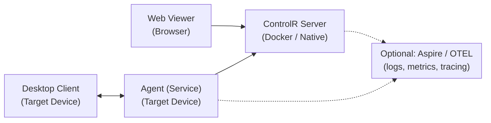

## What is ControlR?

ControlR is a self-hosted remote control system with three components:

- **Server**: An ASP.NET Core application (Docker container or native process) that owns authentication, device registry, SignalR hubs, the REST API, and the built-in WebSocket relay.
- **Agent**: A background service installed on each device you want to manage. Provides remote control, terminal, chat, file system, log streaming, and self-update.
- **Desktop Client**: An Avalonia GUI process launched alongside the agent per active user session. Performs the actual screen capture and input injection. The local user sees when a remote session is active.

## Core Concepts

### Server

The server hosts:

- Connected agents and their status
- Authentication and authorization (Identity, cookie, bearer, PAT, service account, logon token)
- SignalR hubs for real-time commands
- A WebSocket relay for screen streaming
- Telemetry export (OpenTelemetry / Azure Monitor)

### Agent

Each device you want to manage runs an agent. The agent:

- Registers the device with the server at install time
- Maintains an outbound-only SignalR connection (WebSocket) to the server
- Provides remote control, terminal, chat, file system, log streaming, and auto-update
- Runs as `SYSTEM` (Windows service), `root` (Linux systemd, macOS launchd)
- Spawns a per-session Desktop Client process for GUI capture and input forwarding

### Desktop Client

The desktop client runs on the target device and:

- Captures the screen and injects mouse/keyboard for remote control sessions
- Shows the local user when a remote session is active
- Connects to the server's WebSocket relay once a session is established (not before)

### Component Diagram

## Prerequisites

Before installing:

- **Docker** and **Docker Compose** on the host running the server.
- A reachable domain name if you plan to terminate TLS in front of the server (recommended).
- At least 1 GB of RAM available for the server.
- The server listens on container port `8080`; expose it on host port `5120` (default) or change via `ASPNETCORE_HTTP_PORTS`.

## Next Steps

1. **[Installation](/docs/installation)**: Deploy ControlR via Docker Compose or native install.
2. **[Configuration](/docs/configuration)**: Tune `AppOptions` and related settings.
3. **[Reverse Proxy](/docs/admin/reverse-proxy)**: Put HTTPS in front of the server.

## Need Help?

- Join the [Discord community](https://discord.gg/JWJmMPc72H).
- Search or start a [GitHub Discussion](https://github.com/bitbound/ControlR/discussions).
- File an [issue on GitHub](https://github.com/bitbound/ControlR/issues).
