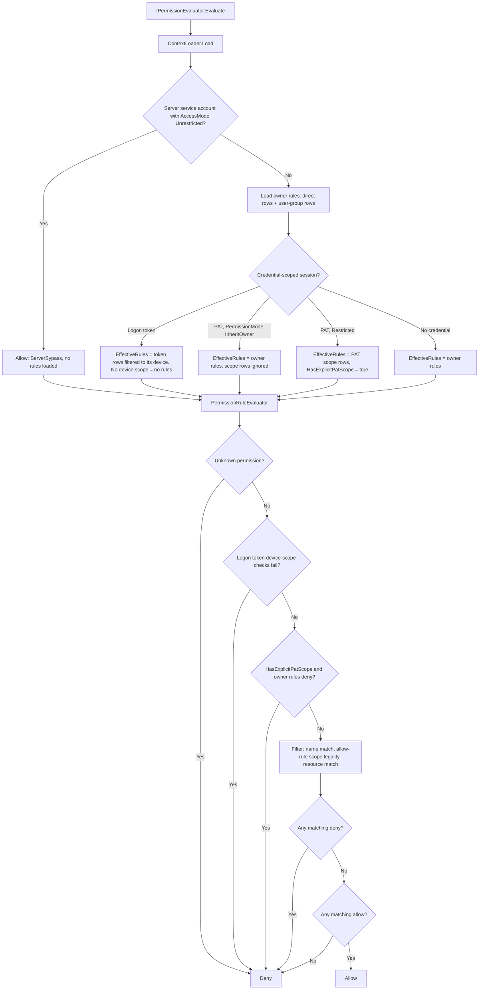

ControlR's authorization layer (Phase 2) replaces the legacy role-based model (`AspNetRoles` / `AspNetUserRoles`) with a fine-grained, scope-based permission system that stores authorization decisions as explicit data rows rather than hard-coded role memberships.

## Why the Change

The legacy system relied on an ASP.NET Identity `AspNetUserRoles` table that mapped users to fixed role names (Server Administrator, Tenant Administrator, Device Superuser, Installer Key Manager, Agent Installer). Every permission a role granted was hard-coded in role membership. Adding a new permission, creating a custom role, or granting partial access was impossible without code changes. There was no way to scope a grant to a specific device, group, or customer, and there were no deny semantics.

Phase 2 stores each authorization decision as a `PermissionAssignment` row that records who (principal), what (permission name), where (scope kind plus scope id), and whether (allow or deny). The evaluation engine interprets these rows at request time through a deterministic algorithm.

## Core Concepts

### Permission Names

Every capability in ControlR has a unique, namespaced permission identifier following the pattern `<resource>.<action>`, such as `device.read`, `device.remote-control.connect`, or `tenant.permissions.write`. The names are constants on `PermissionNames` (in `ControlR.Libraries.Api.Contracts`) and each one is registered in the server's `PermissionCatalog` with metadata. There are 68 catalog entries.

```
server.tenants.read                   -- List all tenants on the server
device.read                           -- View device details
device.remote-control.connect         -- Connect via remote control
tenant.permissions.write              -- Manage permission assignments in a tenant
```

There is no `server.alerts.read` permission. The server alert banner is visible to every signed-in user. Managing the server-wide alert itself falls under `server.settings.write`.

### Permission Metadata and the Catalog

`PermissionCatalog` is a static frozen dictionary keyed by permission name. Each value is a `PermissionMetadata` record carrying the name, category label, display name, description, the set of `AllowedScopeKinds` the permission may be granted at, and a `SelfRemovable` flag. It is the single source of truth for valid permission identifiers. Requests that name an unknown permission are denied by the evaluator and rejected by the assignment API.

`PermissionMetadata.AllowsTenantScope` reports whether the permission's allowed scopes include `Tenant`. This flag marks permissions that are addressable inside one tenant. Granting such a permission at Server scope reaches every tenant, so the assignment API rejects Server-scoped allow rows of tenant-addressable permissions for every principal except server service accounts (see [Server Service Accounts](#server-service-accounts-and-the-unrestricted-mode)).

The catalog exposes two breadth helpers. `GetBroadestLegalScope` returns the broadest allowed scope for a permission. `GetBroadestTenantLegalScope` excludes Server and is what preset application and seeding use, so a preset that targets a tenant never produces a cross-tenant server-scoped grant (see [Permission Presets](#permission-presets)).

### Scope Kinds

The `PermissionScopeKind` enum carries an `Unknown = 0` sentinel (no permission allows it, so a request that omits the scope kind is rejected at validation) plus six real kinds. Ordered from broadest to narrowest:

| Scope Kind | Meaning |
|------------|---------|
| **Server** | All tenants across the entire server. No `ScopeId`, no `OwningTenantId`. |
| **Tenant** | Everything inside one tenant. The scope target is the tenant id. |
| **CustomerTenant** | One customer within a tenant. Device permissions granted here apply to that customer's devices. |
| **DeviceGroup** | One device group (a logical grouping of devices within a tenant). |
| **Device** | A single device (by id). |
| **UserGroup** | One user group. This is the resource the `user-group.assign-users` permission is granted against, meaning "you may add or remove members of this specific group". It is not how group membership grants flow. That flow is handled by the principal side (see [Principal Kinds](#principal-kinds)). |

Two different breadth orderings exist in the code and they are not identical.

`PermissionScopeKinds.GetBreadth` (used when picking the broadest legal scope for a grant) ranks Device and UserGroup at the same level: Device 0, DeviceGroup 1, UserGroup 1, CustomerTenant 2, Tenant 3, Server 4.

`PermissionRuleEvaluator.ScopeSpecificity` (used by the engine when ordering matching rules) ranks: Device 0, DeviceGroup 1, CustomerTenant 2, UserGroup 3, Tenant 4, Server 5. Narrower is more specific.

### Effects

Each assignment has a `PermissionEffect` of `Allow` or `Deny`.

- **Allow** -- The principal may perform the permission at the given scope.
- **Deny** -- Blocks access even when a broader allow exists.

Any matching deny defeats any matching allow, regardless of source or scope breadth. This enables exclusion patterns: grant tenant-wide access, then deny specific devices.

### Principal Kinds

Rows in `PermissionAssignments` target a `PermissionPrincipalKind`:

| Principal Kind | Source |
|---------------|--------|
| **User** | Individual `AppUser` |
| **UserGroup** | A user group. A user's effective rules include all assignment rows scoped to groups they belong to, loaded through `UserGroupMembers`. |
| **ServiceAccount** | Both server-scoped and tenant-scoped service accounts (distinguished by `ServiceAccount.Kind`) |
| **PersonalAccessToken** | Scope-grant rows attached to one PAT |
| **LogonToken** | Scope-grant rows attached to one logon token |

The runtime evaluator uses a different classification, `PrincipalType` (`User`, `UserGroup`, `ServerServiceAccount`, `TenantServiceAccount`). A PAT or logon token session authenticates as its owning user's `User` principal and adds credential claims (`controlr:credential:id`, `controlr:credential:type`) that steer evaluation. The credential rows never authenticate on their own. They reshape a user principal.

A user's effective rules are the union of their direct assignments plus the assignments of every user group they belong to.

### Permission Presets

Because raw permission names are hard for users to reason about, ControlR provides named **presets** in `PermissionPresets`. These are the curated bundles that replaced the legacy role names. There are seven presets.

| Preset | Count | Permissions |
|--------|-------|-------------|
| `Server Administrator` | 13 | `server.authorization-logs.read`, `server.permissions.read`, `server.permissions.write`, `server.settings.write`, `server.tenants.delete`, `server.tenants.read`, `server.tenants.write`, `server.telemetry.read`, `server.service-accounts.read`, `server.service-accounts.write`, `server.service-accounts.rotate-credentials`, `tenant.permissions.read`, `tenant.authorization-logs.read` |
| `Tenant Administrator` | 30 | All 17 `tenant.*` permissions, `user-group.assign-users`, `device-group.assign-devices`, the four `personal-access-token.*` permissions, the three `service-account.*` permissions, `installer-key.read`, `installer-key.write`, `installer-key.manage-all`, `agent.install` |
| `Device Superuser` | 27 | All 27 `device.*` permissions (read, delete, alias, tags, desktop preview, logs, overview, the four remote-control permissions, Ctrl-Alt-Del, clipboard read/write, chat, VNC relay, the five file-system permissions, terminal, logon-token create, wake, power, agent update) |
| `Agent Installer` | 3 | `agent.install`, `installer-key.read`, `installer-key.write` |
| `Installer Key Manager` | 3 | `installer-key.read`, `installer-key.write`, `agent.install` |
| `Service Account Manager` | 3 | `service-account.read`, `service-account.write`, `service-account.rotate-credentials` |
| `Self Service` | 2 | `personal-access-token.self.read`, `personal-access-token.self.write` |

Presets are applied at three points, and each writes one `PermissionAssignment` allow row per permission at the permission's broadest **tenant-legal** scope (`PermissionCatalog.GetBroadestTenantLegalScope`). For device permissions that is Tenant scope, not Server. Server-only permissions (the `server.*` set) fall back to Server scope because no tenant-legal scope exists for them.

1. **Server bootstrap.** When the very first user is created through the self-registration path (and `DisableFirstUserSelfRegistration` is off), `PermissionAssignmentSeeder` (invoked by `UserCreator`) applies the `Server Administrator` preset to that user.
2. **New tenant creation.** When `UserCreator` creates a user that starts a new tenant, it applies `Tenant Administrator`, `Device Superuser`, `Agent Installer`, and `Installer Key Manager`.
3. **User baseline.** Every interactive (non-external) user created through `UserCreator` receives the `Self Service` baseline via `SeedUserBaseline`, mirroring the pre-permissions behavior where self-service PAT management was available to any authenticated user. The seeder dedupes against already-granted rows.

The API can additionally apply any preset combination to a new user (`UsersController.Create` accepts preset names) or to an existing principal (`IPermissionAssignmentManager.ApplyPresets`, with an optional replace mode). User creation gates preset use by authority: `Server Administrator` requires `server.permissions.write`, presets that seed tenant-scope grants require `server.permissions.write` or `tenant.permissions.write`, and `Tenant Administrator` additionally requires `tenant.permissions.deny` unless the caller holds server writes.

`Self Service` is not part of the legacy role backfill. Users that existed before Phase 2 do not receive it from a migration. It is seeded only for users created after the upgrade.

### The PermissionAssignment Entity

```
PermissionAssignment
├── PermissionName    -- e.g., "device.read"
├── Effect           -- Allow or Deny
├── PrincipalKind    -- User, UserGroup, ServiceAccount, PersonalAccessToken, LogonToken
├── PrincipalId      -- GUID identifying the principal
├── ScopeKind        -- Server, Tenant, CustomerTenant, DeviceGroup, Device, UserGroup
├── ScopeId          -- Target id (always null for Server scope)
├── OwningTenantId   -- Tenant that created the row (always null for Server scope)
├── IsEnabled        -- Soft-disable flag. Disabled rows never produce rules.
├── Notes            -- Optional admin notes (max 500 chars)
├── CreatedByPrincipalType  -- Actor type stamp, "system" for seeded rows
└── CreatedByPrincipalId    -- ID of the actor who created it
```

The table has no EF Core tenant query filter, deliberately. Server-scoped rows carry a null `OwningTenantId`, and row visibility for administrators is actor-capability-dependent (see [No Tenant Query Filter](#no-tenant-query-filter-on-permissionassignments)).

### Authorization Change Logs

Every mutation to permission assignments or credential scopes creates an `AuthorizationChangeLog` entry. `AuthorizationChangeLogFactory` fills typed before/after snapshots (serialized to JSON), the actor's principal type and id, the caller's IP address from the ambient HTTP context, and the current W3C trace id as a correlation id. Background services write entries with a null actor and null IP. This provides an auditable trail for compliance and troubleshooting.

## The Evaluation Algorithm

Point-authorization decisions flow through `IPermissionEvaluator`. It exposes four methods: `Evaluate` (one permission against one resource), `EvaluateBatch` (many permission/resource pairs against one loaded context), `EvaluateMany` (many permission names against one resource), and `GetGrantedPolicies` (the client policy projection described later).

Evaluation runs in two steps. `PermissionEvaluationContextLoader` loads and shapes the principal's rule set once. `PermissionRuleEvaluator` (a pure static function) then answers questions against that context.



### Stage 1: Context Loading

`PermissionEvaluationContextLoader` loads all rows with query filters suppressed, then applies its own filtering through `PermissionRuleFactory`. The result is a `PermissionEvaluationContext` record carrying `Principal`, `ServerBypass`, `OwnerRules`, `EffectiveRules`, and `HasExplicitPatScope`.

**Server bypass.** When the principal is a `ServerServiceAccount`, the loader reads the account's persisted `AccessMode`. A value of `Unrestricted` short-circuits to a bypass context with no rules, and every permission evaluates to allow. See [Server Service Accounts](#server-service-accounts-and-the-unrestricted-mode).

**Owner rules.** Rows are converted to `PermissionRule` records tagged with a `RuleSource` (`Direct`, `UserGroup`, `PatGrant`, `LogonTokenGrant`) and a `SourcePriority` used for tie-breaking. For a `User` principal the loader also resolves the user's `UserGroupMembers` rows and folds in each group's assignments as `UserGroup` rules. A principal with no tenant id (and not a server service account) gets zero rules.

Two row filters apply to every rule set for a tenant-bound principal:

- **Tenant ownership.** A row passes when `OwningTenantId` is null (server-scoped) or equal to the principal's current tenant. Rows owned by a former tenant (for example after a cross-tenant move) are inert.
- **Server-scope overreach.** A tenant-bound principal cannot legitimately hold a Server-scope *allow* of a tenant-addressable permission, because such a row reaches outside the tenant. Those allow rows are dropped at load time. Deny rows at Server scope are kept. Dropping a deny would widen access.

**Logon token rules.** For a session carrying a `LogonToken` credential, `EffectiveRules` is replaced by the token's own grant rows, and only rows that are Device-scoped to the token's bound device survive. A token session whose claims carry no device scope has no rules and authorizes nothing.

**PAT rules.** For a session carrying a `PersonalAccessToken` credential, the loader reads the token's `PermissionMode`. `InheritOwner` makes `EffectiveRules` identical to the owner rules and the token's scope rows are not consulted. The default mode, `Restricted`, loads the token's own scope rows as `EffectiveRules` and sets `HasExplicitPatScope`.

### Stage 2: Credential-Grant Bounding

**Logon tokens.** The rule evaluator enforces the device boundary again at evaluation time. The session must carry a device scope and a credential id. A request against a different device is denied before rules are considered. If the token has zero surviving grant rows it can do nothing. Its grants are authoritative and replace, rather than intersect, the creator's own rules. Escalation is prevented at creation time (see [Logon Tokens](#logon-tokens)).

**Personal access tokens.** When `HasExplicitPatScope` is set, a request needs two independent approvals. The owner's effective rules must allow the permission against the requested resource, and one of the token's own scope rows must match that resource. If the owner check fails the request is denied outright. Zero token rows means the token authorizes nothing. The owner check is enforced here at evaluation time, and the same authority check runs at write time so out-of-bounds rows are normally rejected before they are stored (see [Managing Assignments](#managing-assignments)).

### Stage 3: Scope Matching and Deny Resolution

`PermissionRuleEvaluator.EvaluateRules` filters the effective rules:

1. `PermissionName` must match exactly.
2. **Scope legality.** An *allow* rule is dropped when the permission's catalog `AllowedScopeKinds` does not include the rule's `ScopeKind`. A wrong-scope allow must not grant anything, so it fails closed. *Deny* rules are kept at any scope, because honoring a deny is never unsafe.
3. **Resource match** (`PermissionScopeMatcher`):
   - A Server-scope rule matches any resource.
   - A Tenant-scope rule matches when its `ScopeId` equals the resource's `TenantId`.
   - A rule whose kind equals the resource kind matches on `ScopeId == resource.Id`.
   - A DeviceGroup rule matches a Device resource when the device belongs to that group (`ResourceDescriptor.DeviceGroupIds`).
   - A CustomerTenant rule matches a Device resource when the device's `CustomerId` equals the rule's `ScopeId`.

Among the matching rules, any deny defeats every allow. The engine then picks the winning rule by `SourcePriority` ascending (`CredentialPat` 0, `CredentialLogonToken` 1, `Direct` 2, `UserGroup` 3) and then by scope specificity ascending, so credential grants beat direct grants beat group grants, and narrower scopes beat broader ones. Zero matching rules is a default deny. The result is a `PermissionEvaluationResult` carrying the allow/deny flag, the matched rule source and scope, or a denial reason.

## Server Service Accounts and the Unrestricted Mode

A server service account's bypass is a persisted choice, not an inference. The `ServiceAccounts` table carries an `AccessMode` column (`ServiceAccountAccessMode`) with two values:

- **Restricted** (the default, and the mode for every tenant service account): the account evaluates its assignment rows normally. Zero rows deny everything.
- **Unrestricted**: the context loader reports `ServerBypass` and the account passes every permission check with full cross-tenant reach.

The mode is chosen when the account is created. Selecting Unrestricted requires the creator to hold `server.permissions.write` evaluated at Server scope. The current management API and UI (`UpdateServiceAccountRequestDto`) expose only name, description, and enable/disable, so the mode is not editable after creation. The evaluation never inspects assignment rows to decide the bypass, so attaching or removing rows cannot silently flip an account between modes.

The earlier design inferred the bypass from the absence of assignment rows. Migration `20260827021622_AddPrincipalAccessModes` replaced that design. It added the columns defaulting to `Restricted` and backfilled `Unrestricted` for server accounts that had no assignment rows, preserving each existing account's behavior.

Because assigning permissions to a server service account could shadow its cross-tenant reach, `PermissionAssignmentManager` requires the actor to hold `server.permissions.write` before creating, updating, deleting, or replacing assignments that *target* a server-kind service account, whatever the rows' own scope. The UI refuses to open the permission panel for an Unrestricted account.

## Personal Access Tokens

PATs authenticate as their owning user (`PrincipalType.User` plus credential claims). The `PersonalAccessTokens` table carries a `PermissionMode` (`PersonalAccessTokenPermissionMode`):

- **Restricted** (the default): the token evaluates only its own scope rows. Zero rows deny everything. Each request additionally requires the owner's effective permissions to cover it, checked at evaluation time and enforced at creation time, so a token can never outlive its owner's rights.
- **InheritOwner**: the token evaluates exactly as its owning user. Scope rows are not consulted.

A background sweep, `PatScopeTrimBackgroundService`, runs every 15 minutes and deletes allow rows that the owner no longer covers (for example after the owner lost a permission). The rows were already inert at evaluation time, so this is storage hygiene rather than a security boundary, and each trim is recorded in the authorization change log. Deny rows are never trimmed. Denies are deliberately allowed to exceed the owner's reach.

## Logon Tokens

A logon token is a single-use, device-bound credential (`LogonTokens` table: hashed token with display prefix, `DeviceId`, `UserId`, `ExpiresAt`, `IsConsumed`, optional `AllowedDesktopSessionIds`). Creation is gated by `device.logon-token.create` and by a grantor check: every requested scope is evaluated against the creator's effective permissions before anything is written.

- Without explicit scopes the token is created with baseline grants: Device-scoped `device.read`, `device.overview.read`, `device.remote-control.connect`, and `device.remote-control.interact` on its device.
- With explicit scopes the token is created without the baseline and the explicit list becomes its full permission set. The scopes must be Device-scoped, must target the token's own device, and `device.read` is unioned in automatically.

Redeeming a token consumes it and signs the redeemer in as the token's creating user with claims that pin the session: `controlr:credential:type` = `LogonToken`, `controlr:credential:id`, and a device-session-scope claim. From there the evaluator replaces the user's own rules with the token's device-scoped grants, so the session is bounded by the token, not by the creator's breadth.

`IDesktopSessionAccessAuthorizer` adds the system-session layer. A logon-token session may act only on its bound device, and when the token carried an allowed-session list the requested system session id must be in it. Non-logon-token principals pass unconditionally and are governed by ordinary permissions instead.

## Policies and Claims Wiring

### Server-Side Policies

Policies come from two static registries, registered in `AuthorizationRegistrationExtensions`:

- **`PermissionPolicies.Definitions`** -- maps each `PolicyNames` entry to a permission name plus the resource scope kind the policy's canonical resource lives at. Most entries are Tenant or Server. `RequireDeviceGroupAssignDevices` sits at DeviceGroup and `RequireUserGroupAssignUsers` at UserGroup. Registered with `.RequirePermission(permission, scopeKind)`.
- **`DeviceResourcePolicies`** -- one named policy per device permission (`DeviceRead`, `DeviceRemoteControlConnect`, ...), each registered at Device scope for resource-based checks.

Both attach a `PermissionRequirement` (permission name plus a bare `ResourceDescriptor`) handled by one handler, `PermissionRequirementHandler : AuthorizationHandler<PermissionRequirement, object>`.

Evaluating one request:

1. The handler converts `ClaimsPrincipal` to a `PrincipalDescriptor` with the `ToPrincipalDescriptor()` extension (`ClaimsPrincipalExtensions`). Missing or invalid principal claims deny.
2. It resolves the resource. A `Device` entity passed as the authorization resource is enriched by `IResourceDescriptorFactory.CreateDevice` with the device's tenant, customer, and group memberships. A tenant-scoped requirement with no id resolves to the principal's tenant. Other scoped kinds resolve through the factory, which fails closed when the target does not exist in the principal's tenant.
3. It delegates to `IPermissionEvaluator.Evaluate` and calls `context.Succeed` or `context.Fail`. Evaluation exceptions fail closed.

Resource-based device checks go through ASP.NET Core's `IAuthorizationService`, for example `await authorizationService.AuthorizeAsync(User, device, DeviceResourcePolicies.Read)`. There is no custom authorizer facade.

### Client-Side Policy-Grant Claims (Blazor)

The Blazor WebAssembly client cannot run the evaluator, so declarative UI authorization works through claims:

1. When the Blazor circuit starts, `IdentityRevalidatingAuthenticationStateProvider` builds a `PrincipalDescriptor` for the user and calls `IPermissionEvaluator.GetGrantedPolicies(principal, ct)`. That method evaluates every policy in `PermissionPolicies.ClientDefinitions` (the subset of definitions whose resource kind is Tenant or Server) against the principal's server and tenant resources and returns the set of allowed **policy names**.
2. Each granted policy name is persisted as a claim of type `controlr:client-policy` (`PermissionPolicies.ClientPolicyClaimType`).
3. The client registers the same policy names with `RequireClaim(PermissionPolicies.ClientPolicyClaimType, policyName)` in `ClientAuthorizationExtensions`. `[Authorize(Policy = PolicyNames.RequireServerTenantsRead)]` on a page succeeds when that claim is present.

Resource-scoped policies (DeviceGroup, UserGroup, and all `DeviceResourcePolicies`) are deliberately never projected as global claims, because a claim answers one resource-independent question. Device access decisions always go through the server.

Note that the projection uses the *user's* identity, not the session's credential scope. A page gated this way reflects what the owning user can do and does not shrink for a PAT session that carries a narrower scope. Access control always happens server-side. The claims exist for UI visibility.

## Device Enumeration (Query-Level Scope Projection)

Listing devices cannot afford a per-device evaluator call, so `IDeviceAccessScopeResolver` derives a `DeviceAccessScope` from the principal's `device.read` rules, and `ApplyAccessScope` compiles it into the device `IQueryable` at the database level.

`DeviceAccessScope` is a record with a tenant boundary, a server-wide flag, included and excluded id sets for Tenant, DeviceGroup, Customer, and Device, and an optional `RequiredOwnerScope`. There is no scope-kind enum and no tag-based category. Tags are device metadata and carry no authorization role anywhere in the permission or device-scope layer. Tag *management* is gated by `device.tags.write` and `tenant.tags.write`. The catalog also ships `device.tags.read`, but no code evaluates it and tag ids ride along on the device record, so seeing a device's tags follows `device.read`.

Resolution order:

1. A logon-token session missing its credential or device-scope claims gets `DeviceAccessScope.None()`.
2. `ToPrincipalDescriptor()` failure gets `None()`.
3. The context loader runs (the same component point authorization uses), so the **server bypass is handled inside the resolver** and produces `ServerWide()`. Callers do not special-case it.
4. No `device.read` rules in `EffectiveRules` gets `None()`.
5. For a logon-token session the rules are filtered to allow/deny rows Device-scoped to the token's device. A deny, or no allow, gets `None()`. Otherwise the scope includes exactly that one device.
6. Otherwise allow rules fill the inclusion sets (a Server-scope allow sets `IncludesServerWide`) and deny rules fill the exclusion sets. A **Server-scope deny** is recorded as `ExcludedTenantIds` containing `Guid.Empty`, and `ApplyAccessScope` recognizes the sentinel and returns an empty query. No allow rules at all also produces `None()`.
7. When the session is a Restricted PAT (`HasExplicitPatScope`), the same set-building runs a second time over the owner's `device.read` rules and attaches the result as `RequiredOwnerScope`. The compiled query intersects both scopes, reproducing the evaluator's rule that a PAT cannot exceed its owner.

`ApplyAccessScope` compiles to one predicate: devices inside the tenant boundary, included by server-wide flag, tenant, direct device id, customer, or group membership, minus excluded tenants, devices, customers, and groups.

A related service, `IDeviceAuthorizationService`, answers per-device questions for flows like agent installation and tag assignment (`CanInstallAgentOnDevice`, `CanAssignTagOnDevice`) by evaluating the named permission against a device resource, so device-scoped denies are honored even when broader tenant rights exist.

## Managing Assignments

`PermissionAssignmentManager` (`IPermissionAssignmentManager`) implements the admin API: create/update/delete single or batch assignments, apply presets, and replace a principal's assignments for the scope kinds being sent. Every write emits an `AuthorizationChangeLog` entry, duplicates are rejected with a conflict, and replaces serialize on a keyed async lock inside a transaction. Key guardrails:

- **Write authority**: managing tenant-scoped rows requires `tenant.permissions.write`. Managing server-scoped rows requires `server.permissions.write`. Creating or editing a row whose effect is Deny additionally requires `tenant.permissions.deny`, at any target scope including Server.
- **Delegated administration**: the write check tests only the management permission, not whether the actor holds the permission being granted. A `tenant.permissions.write` holder can grant any tenant-scoped permission to anyone, including themselves, so that permission is de facto full tenant admin. This is intentional (see [Delegated Administration](#delegated-administration-for-direct-grants)). User creation narrows the rule for the `Tenant Administrator` preset, which also demands `tenant.permissions.deny`, so a `tenant.users.write` holder cannot mint a new permission manager.
- **Credential principals are grantor-bounded**: rows written to a PAT or logon token principal are validated against the owner's effective permissions at write time (`ValidateCredentialPrincipalScope` delegating to `ICredentialScopeService.ValidateGrantableScopes`, which evaluates each scope against the owner and rejects Server-scope grants of tenant-addressable permissions to a credential). Logon-token rows must be Device-scoped to the token's own device. Deny-effect credential rows skip the owner-authority check because a deny confers nothing.
- **Scope validation**: the permission must exist, the requested scope kind must be in the permission's `AllowedScopeKinds`, `ScopeId` is required for Device/DeviceGroup/CustomerTenant/UserGroup and forbidden at Server scope, the target must live in the acting tenant, and Server-scoped allows of tenant-addressable permissions are accepted only when the target principal is a server service account.
- **Tenant isolation**: `IsVisibleToTenant` gates which rows an actor can see. Tenant-owned rows are visible only to the owning tenant. Server-scoped (null-owned) rows additionally require the actor to hold `server.permissions.read` or `server.permissions.write`.
- **Self-protection**: see the [Self-Removable Guard](#self-removable-guard).

`IPermissionEvaluationContextLoader`, `IPermissionEvaluator`, and `IResourceDescriptorFactory` are also exposed to server code directly. The V1 `EffectivePermissionsController` answers "may principal P hold permission X at scope S" for integrators.

## Key Types Reference

| Type | Location | Purpose |
|------|----------|---------|
| `PermissionAssignment` | Data entity | One explicit allow/deny row |
| `PermissionEffect` | Enum | Allow, Deny |
| `PermissionPrincipalKind` | Enum | User, UserGroup, ServiceAccount, PersonalAccessToken, LogonToken (row targets) |
| `PermissionScopeKind` | Enum | Unknown sentinel, Server, Tenant, CustomerTenant, DeviceGroup, Device, UserGroup |
| `PermissionNames` | Static constants | The canonical permission-name strings (API contracts library) |
| `PermissionMetadata` | Record | Display name, description, allowed scope kinds, self-removable flag |
| `PermissionCatalog` | Static | Registry of permissions, scope-legality and breadth helpers |
| `PermissionPresets` | Static | Named permission bundles that replaced the legacy roles |
| `PermissionRequirement` | Class | ASP.NET Core requirement carrying permission name + resource descriptor |
| `PermissionRequirementHandler` | Class | The single handler bridging policies to the evaluator |
| `IPermissionEvaluator` / `PermissionEvaluator` | Interface / class | `Evaluate`, `EvaluateBatch`, `EvaluateMany`, `GetGrantedPolicies` |
| `IPermissionEvaluationContextLoader` / `PermissionEvaluationContextLoader` | Interface / class | Loads assignments, decides bypass, shapes owner/effective rules |
| `PermissionEvaluationContext` | Record | Principal, ServerBypass, OwnerRules, EffectiveRules, HasExplicitPatScope |
| `PermissionRuleEvaluator` | Static | Pure rule matching, deny resolution, specificity ordering |
| `PermissionRule` / `PermissionRuleFactory` | Record / static | A rule (assignment plus source and priority) and the shared row-filtering factory |
| `RuleSource` | Enum | Direct, UserGroup, PatGrant, LogonTokenGrant |
| `SourcePriority` | Enum | CredentialPat 0, CredentialLogonToken 1, Direct 2, UserGroup 3 (lower wins) |
| `PermissionScopeMatcher` | Static | Rule-to-resource matching |
| `PrincipalDescriptor` | Record | Canonical principal for evaluation, from `ClaimsPrincipal` |
| `ClaimsPrincipalExtensions.ToPrincipalDescriptor()` | Extension | Builds the descriptor from auth claims |
| `PrincipalType` | Enum | User, UserGroup, ServerServiceAccount, TenantServiceAccount |
| `CredentialType` | Enum | PersonalAccessToken, LogonToken, ServiceAccountCredential |
| `ResourceDescriptor` | Record | Kind, id, tenant, customer, and device-group ids of the resource |
| `IResourceDescriptorFactory` | Interface | Builds descriptors for server, tenant, device, and scoped targets |
| `PermissionEvaluationResult` | Class | Allow with matched source/scope, or deny with reason |
| `IDeviceAccessScopeResolver` / `DeviceAccessScopeResolver` | Interface / class | Device enumeration scope projection |
| `DeviceAccessScope` | Record | Tenant boundary, server-wide flag, include/exclude id sets, required owner scope |
| `ServiceAccountAccessMode` | Enum | Restricted, Unrestricted (server service accounts) |
| `PersonalAccessTokenPermissionMode` | Enum | Restricted (default), InheritOwner |
| `ICredentialScopeService` | Interface | Grant-authority checks and logon-token scope writes |
| `PatScopeTrimBackgroundService` | Background service | Periodic removal of owner-uncovered PAT allow rows |
| `IDesktopSessionAccessAuthorizer` | Interface | Logon-token device and system-session gate |
| `IDeviceAuthorizationService` | Interface | Device-scoped checks for install and tag flows |
| `IPermissionAssignmentManager` / `PermissionAssignmentManager` | Service | Admin CRUD: presets, write authority, tenant isolation, self-protection, audit logging |
| `IPermissionAssignmentSeeder` / `PermissionAssignmentSeeder` | Service | Preset seeding for bootstrap, new tenants, and the user baseline |
| `PermissionPolicies` / `PolicyNames` | Static | Policy-to-permission definitions, `ClientPolicyClaimType`, client-projectable subset |
| `DeviceResourcePolicies` | Static | Device-resource policies (`DeviceRead`, `DeviceRemoteControlConnect`, ...) |
| `AuthorizationChangeLog` | Data entity | Audit trail for authorization mutations |
| `IAuthorizationChangeLogFactory` | Interface | Builds audit entries with snapshots, IP, and trace id |

## Migration from Legacy Roles

The migration `20260813192551_Permissions_Phase2` performs the transformation:

1. **Backfill**: maps legacy `AspNetUserRoles` memberships to `PermissionAssignment` allow rows with a SQL role-to-permission table. Each row lands at the permission's broadest legal scope, so `server.*` permissions backfill to Server scope (null owning tenant) and everything else to Tenant scope (the user's tenant). The mapping mirrors the preset lists, at 13 rows for Server Administrator (11 Server-scope plus `tenant.permissions.read` and `tenant.authorization-logs.read` at Tenant scope), 30 for Tenant Administrator, 27 for Device Superuser, and 3 each for the two installer presets. The table is a superset of the presets so no upgraded user is under-privileged. It predates `Self Service`, so that baseline comes only from user-creation seeding.
2. **Drop**: removes `AspNetRoleClaims`, `AspNetUserRoles`, and `AspNetRoles`, plus `AppUserTag` (superseded by customer and device scoping).
3. **Schema additions**: `CustomerId` on `Devices`, plus `CreatedByUserId`, `ExpiresAt`, and `RevokedAt` on `PersonalAccessTokens`.
4. **Create**: `PermissionAssignments`, `AuthorizationChangeLogs`, `Customers`, `DeviceGroups`, `DeviceGroupMembers`, `UserGroups`, `UserGroupMembers`, and `LogonTokens`, with indexes on the common lookup paths.

The backfill preserves existing access on upgrades. On fresh databases it is a no-op because the role tables are empty.

Two later migrations changed the model itself. `20260827021622_AddPrincipalAccessModes` replaced the inferred server-account bypass and the inferred PAT owner-inheritance with the explicit `AccessMode` and `PermissionMode` columns, backfilling each principal's prior behavior. `20260912020000_RemoveOrphanedServerAlertsReadGrants` deletes the `server.alerts.read` rows that the original Phase 2 backfill had seeded after the permission was removed from the catalog and the alert banner became visible to every signed-in user.

## New Entities

| Entity | Purpose |
|--------|---------|
| `Customer` | Customer entity within a tenant (unique name per tenant). Devices optionally belong to customers. |
| `DeviceGroup` | Logical grouping of devices within a tenant (unique name per tenant). |
| `DeviceGroupMember` | Many-to-many join: device + device group. |
| `UserGroup` | Logical grouping of users within a tenant. Assignments targeting the group apply to members' effective rules. |
| `UserGroupMember` | Many-to-many join: user + user group. |
| `LogonToken` | Single-use, device-bound credential with expiry and optional desktop-session restrictions. Its grants live as `PermissionAssignment` rows. |

## Design Decisions

### Delegated Administration for Direct Grants

Direct assignment writes are checked against the management permissions only (`tenant.permissions.write` / `server.permissions.write`, plus `tenant.permissions.deny` for deny rows). The system does not require the actor to hold the permission being granted, so a tenant permission writer can grant any tenant-scoped permission, including to themselves. This is an accepted privilege-escalation trade-off. The management permissions are `selfRemovable: false`, the catalog's scope whitelist plus the server-scope rejection keep a tenant writer from minting Server-scoped reach for tenant-addressable permissions, and every change is audit-logged. Credential principals (PAT and logon token) are the exception: their rows are bounded by the grantor's effective permissions at write time and, for Restricted PATs, re-checked at evaluation time, so a credential can never exceed its creator.

### No Tenant Query Filter on PermissionAssignments

The table deliberately has no EF Core tenant query filter. Server-scoped rows carry a null `OwningTenantId`. Administrator visibility is actor-capability-dependent and lives in `PermissionAssignmentManager.IsVisibleToTenant`, which shows server-scoped rows only to holders of `server.permissions.read` or `server.permissions.write`. The evaluation loader must read rows for any principal kind, including server service accounts that have no tenant binding, and it enforces tenant membership in its own predicates instead.

### Persisted Unrestricted Mode for Server Service Accounts

An early design granted the bypass whenever a server service account had zero assignment rows, which meant attaching a single row collapsed the account and deleting it later could silently restore a bypass the operator believed they had removed. The shipped model stores the decision on the account (`AccessMode.Unrestricted`), chosen at creation behind a `server.permissions.write` check, and evaluation never infers it from row counts. Restricted accounts, including ones whose rows were all deleted, fail closed.

### Self-Removable Guard

Three permissions are marked `selfRemovable: false` in the catalog: `server.permissions.write`, `tenant.permissions.write`, and `tenant.permissions.deny`. When an actor changes their **own** direct assignments, `PermissionAssignmentManager.FindViolatedSelfProtected` rebuilds the actor's rule set before and after the change and blocks the write if the change would flip any non-self-removable permission from allowed to denied. The check guards only the actor's own principal, so another authorized holder may still revoke these grants.

### Fail-Closed Everywhere

Unknown permission names deny. Missing principal claims deny. A resource that cannot be resolved denies. An exception during evaluation denies. A Restricted credential with zero scope rows authorizes nothing. There is no fallback to a broader grant and no silent default-allow.

### Deny Overrides Allow

Any matching deny beats any matching allow, regardless of source or scope breadth. This enables exclusion patterns: grant tenant-wide `device.read` to a group, then add a device-scoped deny for a critical device. The engine honors the deny even when it is narrower than the allow, and deny rules survive both scope-legality filtering and the server-overreach drop.
