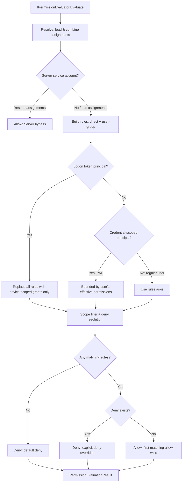

# Permission System

ControlR's authorization layer (Phase 2) replaces the legacy role-based model (`AspNetRoles` / `AspNetUserRoles`) with a fine-grained, scope-based permission system that stores authorization decisions as explicit data rows rather than hard-coded role memberships.

## Why the Change

The legacy system relied on an ASP.NET Identity `AspNetUserRoles` table that mapped users to fixed role names (Server Administrator, Tenant Administrator, Device Superuser, Installer Key Manager, Agent Installer). Every permission a role granted was hard-coded in role membership. Adding a new permission, creating a custom role, or granting partial access was impossible without code changes: there was no way to scope a grant to a specific device, group, or customer, and no deny semantics.

Phase 2 stores each authorization decision as a `PermissionAssignment` row that records who (principal), what (permission name), where (scope kind + scope id), and whether (allow or deny). The evaluation engine interprets these rows at request time through a deterministic algorithm.

## Core Concepts

### Permission Names

Every capability in ControlR has a unique, namespaced permission identifier following the pattern `<resource>.<action>`, such as `device.read`, `device.remote-control.connect`, or `tenant.permissions.write`.

```
server.admin                          -- Full server administrator
server.alerts.read                    -- View server alerts
device.read                           -- View device details
device.remote-control.connect         -- Connect via remote control
device.file-system.write              -- Write files on a device
tenant.users.write                    -- Manage users in a tenant
```

Each permission has metadata (display name, description) and a list of allowed scope kinds defined in the `PermissionCatalog`.

### Scope Kinds

Permissions can be granted at several resource granularities, ordered from narrowest to broadest:

| Scope Kind | Meaning |
|------------|---------|
| **Device** | A single device (by ID) |
| **DeviceGroup** | A device group (logical grouping of devices) |
| **UserGroup** | A user group (used by `user-group.assign-users`; assignment rows scoped here apply through group membership) |
| **CustomerTenant** | A customer within a tenant |
| **Tenant** | All devices within a tenant |
| **Server** | All tenants across the entire server |

A server scope has no `ScopeId` and no `OwningTenantId` because it spans everything. All other scopes carry a scope target ID and the tenant that owns the assignment.

### Effects

Each assignment has an effect:

- **Allow** -- The principal may perform the permission at the given scope.
- **Deny** -- Explicitly overrides allow, even at a broader scope.

Deny always wins, regardless of source or scope breadth. This enables exclusion patterns: grant tenant-wide access to a group, then deny specific devices.

### Principal Kinds

Permission assignments target these principal types:

| Principal Kind | Source |
|---------------|--------|
| **User** | Individual `AppUser` |
| **UserGroup** | A user group (a user's effective permissions include all assignments scoped to groups they belong to) |
| **ServiceAccount** | Both server-scoped and tenant-scoped service accounts |
| **PersonalAccessToken** | A PAT owned by a user (optional least-privilege restriction) |
| **LogonToken** | A device-bound self-contained grant (see below) |

A user's effective permissions are the union of their direct assignments plus those inherited through all user groups they belong to.

### Permission Presets

Because raw permission names are hard for users to reason about, ControlR provides named **presets** -- curated bundles of permission names that replace the legacy role bundles (`Server Administrator`, `Tenant Administrator`, `Device Superuser`, etc.). These are defined by `PermissionPresets` as static string-to-permission-list dictionaries.

Presets are used two ways:

1. **Bootstrap/seed**: When a tenant's first user is created, `PermissionAssignmentSeeder` (via `UserCreator`) applies the `ServerAdministrator` preset as a grant on that user. When a non-admin user is created, the API can apply any combination of presets to the new user.
2. **Admin-driven assignment**: `IPermissionAssignmentManager.ApplyPresets` lets a tenant administrator apply preset names to any principal (user or user group). Preset application writes one `PermissionAssignment` row per permission in the preset at that permission's broadest legal scope (see `PermissionCatalog.GetBroadestLegalScope`).

The current preset catalog:

| Preset name | Permission count | Purpose |
|-------------|------------------|---------|
| `Server Administrator` | 13 | Full server-wide admin: alerts, tenants, telemetry, service accounts, cross-tenant permission management |
| `Tenant Administrator` | 30 | Full tenant admin: users, groups, device groups, customers, tags, permissions, installers, service accounts |
| `Device Superuser` | 27 | Full device operations: remote control, file system, terminal, power, agent updates |
| `Agent Installer` | 1 | Just `agent.install` |
| `Installer Key Manager` | 3 | Installer key read/write + agent install |
| `Service Account Manager` | 3 | Service account read/write/rotate |

Note that the preset catalog is the source of truth for current permissions. The legacy role-to-permission backfill (see below) used slightly smaller sets, because several permissions were added later and are not backfilled to existing users. Presets are the recommended way to grant broad access. Custom one-off grants use the raw assignment API.

### The PermissionAssignment Entity

```
PermissionAssignment
├── PermissionName    -- e.g., "device.read"
├── Effect           -- "Allow" or "Deny"
├── PrincipalKind    -- "User", "UserGroup", "ServiceAccount", "PersonalAccessToken", "LogonToken"
├── PrincipalId      -- GUID identifying the principal
├── ScopeKind        -- "Device", "DeviceGroup", "UserGroup", "CustomerTenant", "Tenant", "Server"
├── ScopeId          -- Optional target (null for Server scope)
├── OwningTenantId   -- Tenant that created this assignment (null for Server scope)
├── IsEnabled        -- Soft-disable flag
├── Notes            -- Optional admin notes
├── CreatedByPrincipalType  -- e.g., "user", "service-account"
└── CreatedByPrincipalId    -- ID of the actor who created it
```

The table has no tenant query filter. Server-scoped rows carry a null `OwningTenantId`, and visibility is enforced at the API layer by the assignment manager, not at the EF Core level.

### Authorization Change Logs

Every mutation to permission assignments (or credentials) creates an `AuthorizationChangeLog` entry with typed before/after snapshots, the actor's identity, IP address, and a W3C correlation trace ID. This provides an auditable trail for compliance and troubleshooting.

## The Evaluation Algorithm

All point-authorization decisions flow through `IPermissionEvaluator.Evaluate()`. The algorithm is deterministic and follows these stages:



### Stage 1: Rule Resolution

`IPermissionRuleResolver` loads assignments from the database and assembles a flat rule list. For users, it also follows their user group memberships and loads assignments scoped to each group. The two sources are tracked via `RuleSource` enums (`Direct` or `UserGroup`).

Server service accounts with **zero** assignments get the server bypass: unrestricted access across all tenants. If any assignment exists (even all disabled), the bypass is permanently lost -- disabling the last assignment fails closed rather than reverting to bypass. This is an opt-in mechanism for the zero-config RMM use case.

For tenant-confined principals (users and tenant service accounts), only rows owned by the principal's current tenant -- plus server-scoped rows (null owning tenant) -- are included. Rows owned by a former tenant (e.g., after a cross-tenant move) are inert until cleaned up.

### Stage 2: Credential-Grant Bounding

The evaluator distinguishes between several principal types:

**Logon Tokens** are self-contained device grants. They are issued to a recipient who may have no permissions of their own (e.g., an external user accessing a device). Their grants are authoritative and device-bound:

1. The logon token's device scope is a hard security boundary enforced before any rule evaluation.
2. If grants exist, all rules from the principal and user groups are replaced with only the logon token's device-scoped grant rows.
3. Zero rows grants nothing.

**Personal Access Tokens** authenticate as their owning user. Without explicit scope rows, a PAT inherits the user's full effective permissions (user-equivalent). With explicit scope rows, those rows are an optional least-privilege restriction, bounded by the user's own effective rights:

1. Each PAT scope row survives only when the user's own rules cover it.
2. Device-scoped rows are checked precisely against the target device (loading its group/customer membership).
3. Other rows use scope coverage rules.
4. A matching user deny discards the row.
5. Zero surviving rows means the PAT has no grants.

### Stage 3: Scope Matching & Deny Resolution

The matching step filters rules by:

1. `PermissionName` must match exactly.
2. `ScopeKind` must be compatible with the requested resource.
3. `ScopeId` must match the resource ID (or be absent for broader scopes).

Among matching rules:

- **Explicit deny always wins** over allow, regardless of source or scope.
- Deny rules use source priority (`SourcePriority` enum: credential grant > direct > user group) for tie-breaking, then scope specificity (narrower scope is more specific).
- If any matching allow exists (and no deny overrides), the access is permitted.
- No matching rules means default deny.

## The Permission Catalog

`PermissionCatalog` is a static dictionary that defines every permission with its metadata: display name, description, and a list of allowed scope kinds. It is the single source of truth for valid permission identifiers.

Example permission definitions:

```
server.admin                       -- [Server]         Full administrative access to server-wide settings and operations.
device.read                        -- [Device, DeviceGroup, CustomerTenant, Tenant]  View device details and status.
device.remote-control.connect      -- [Device, DeviceGroup, CustomerTenant, Tenant]  Initiate a remote control session.
tenant.permissions.write           -- [Tenant]          Create/update allow permission assignments.
tenant.permissions.deny            -- [Tenant]          Create/update deny assignments. Required for ANY deny at ANY scope, including server scope.
```

Certain permissions have constraints:

- `selfRemovable: false` -- Four permissions (`server.admin`, `server.permissions.write`, `tenant.permissions.write`, `tenant.permissions.deny`) are marked this way, so a principal cannot drop their last grant of that permission from themselves (see [Self-Removable Guard](#self-removable-guard)).
- `tenant.permissions.deny` -- A gateway permission: you need this to create deny-effect assignments at any scope, including server scope.

## Authorization in Practice

### How the Authorization Handler Bridges to the Evaluator

All policies in the system carry a single `PermissionRequirement` and are evaluated by one handler, `PermissionRequirementHandler : AuthorizationHandler<PermissionRequirement, object>`. The policies come from two registration sources:

- **`PermissionPolicies`** -- permission name -> policy, registered at the default **Tenant** scope. Covers tenant/server-level operations (users, settings, alerts, permission management, ...).
- **`DeviceResourcePolicies`** -- policy name -> permission, registered at **Device** scope. One policy per device permission (e.g., `DeviceRead`, `DeviceRemoteControlConnect`). These are used for per-device point authorization where the `Device` entity is the authorization resource: `IAuthorizer.AuthorizeAsync(user, device, DeviceResourcePolicies.Read)`.

Evaluation of a single request:

1. The policy's `PermissionRequirement` (permission name + requested scope kind, e.g., `Tenant` or `Device`) is matched by `PermissionRequirementHandler.HandleRequirementAsync()`.
2. It builds a `PrincipalDescriptor` from the authenticated user's claims (using `PrincipalDescriptorBuilder`), resolving principal type, ID, tenant, credential info, and device scope.
3. It resolves the resource descriptor. For a `Device` resource, it enriches the descriptor with the device's tenant, customer, and device-group membership. Otherwise the requirement's descriptor (with the principal's tenant applied) is used.
4. It delegates to `IPermissionEvaluator.Evaluate()`.
5. On success, `context.Succeed(requirement)` is called; on failure, the denial reason is logged.

### Device Enumeration (Query-Level Scope Projection)

The `IDeviceAccessScopeResolver` produces a `DeviceAccessScope` from a principal's `device.read` permissions. This scope is consumed by LINQ query extension methods (e.g., `ApplyAccessScope`) that filter the device query at the database level:

1. Logon tokens --> `SingleDevice(deviceId)`
2. Server service account bypass --> no filter (handled by callers before reaching this resolver)
3. Load `device.read` rules from `IPermissionRuleResolver`
4. Deny rules become exclusion sets (or `DeviceAccessScope.None` at Server/Tenant scope)
5. Allow rules produce inclusion categories: tenant-wide, device groups, customers, specific devices
6. The combined result mirrors the point evaluator's deny-overrides-allow semantics

### Desktop Session Access

`IDesktopSessionAccessAuthorizer` controls whether a principal can use a desktop session on a given device and system session:

- Logon tokens: verify device scope matches, then optionally verify system session IDs if `desktop-session-restriction` claim is set.
- Non-logon-token principals: always allowed (use other authorization).

### Client-Side Permission Claims (Blazor)

The Blazor client cannot run the server-side evaluator, so permission-based visibility in the UI works through claims. The flow:

1. `IdentityRevalidatingAuthenticationStateProvider` (server-side Blazor revalidation) calls `IPermissionEvaluator.GetEffectivePermissionNames()` for the connected user when persisting authentication state to the WebAssembly circuit.
2. Each effective permission name is emitted as a claim of type `controlr:permission` (`PermissionPolicies.PermissionClaimType`).
3. The client registers its own policies from the same `PermissionPolicies.PolicyToPermission` mapping, but as claim checks (e.g., `[Authorize(Policy = "RequireServerTenantsRead")]` succeeds when the `controlr:permission` claim value is `server.tenants.read`).

`PermissionPolicies` is the single source of truth for policy-to-permission mappings, registered on both the server (delegating to the evaluator) and the client (checking claims).

Note that client-side checks use the *user's* effective permissions and therefore do not reflect PAT or logon-token scope bounding -- they are for UI visibility, not for enforcing access. Access control always happens server-side through the evaluator.

### Managing Assignments

`PermissionAssignmentManager` (`IPermissionAssignmentManager`) is the service that implements the admin API: create/update/delete assignments, apply presets, and replace a principal's assignments for given scope kinds. Every write emits an `AuthorizationChangeLog` entry. Key guardrails:

- **Write authority**: managing tenant-scoped allow assignments requires `tenant.permissions.write`; deny-effect assignments (at any scope) require `tenant.permissions.deny`; managing server-scoped assignments requires `server.permissions.write`.
- **Delegated administration**: write authority checks only the management permission, not whether the actor holds the permission being granted. A `tenant.permissions.write` holder can grant any tenant-scoped permission to any principal, including themselves, so that permission is de facto full tenant admin. This is intentional. The asymmetry is deliberate: direct assignment grants are delegated-admin, while credential grants (PAT and logon token scope rows) are grantor-bounded at write time (see `ValidateCredentialPrincipalScope`), so credentials can never exceed the grantor's effective rights.
- **Tenant isolation**: `IsVisibleToTenant` restricts which rows an actor can see -- tenant-owned rows are visible only to the owning tenant, and server-scoped (null-owned) rows additionally require `server.permissions.read` or `server.permissions.write`.
- **Self-protection**: see the [Self-Removable Guard](#self-removable-guard) design decision.
- **Credential principal validation**: assignments written to a PAT or logon token principal are validated at write time against the token owner's effective permissions (`ValidateCredentialPrincipalScope`), so out-of-bounds rows are rejected early instead of being silently discarded at evaluation time.

## Key Types Reference

| Type | Location | Purpose |
|------|----------|---------|
| `PermissionAssignment` | Data entity | Stores an explicit permission grant/deny |
| `PermissionEffect` | Enum | Allow or Deny |
| `PermissionPrincipalKind` | Enum | User, UserGroup, ServiceAccount, PersonalAccessToken, LogonToken |
| `PermissionScopeKind` | Enum | Device, DeviceGroup, CustomerTenant, Tenant, Server, UserGroup |
| `PermissionMetadata` | Record | Metadata for a permission name |
| `PermissionCatalog` | Static | Registry of all permissions with metadata + allowed scopes |
| `PermissionRequirement` | Class | ASP.NET Core authorization requirement |
| `PermissionRequirementHandler` | Class | Authorization handler bridging to `IPermissionEvaluator` |
| `IPermissionEvaluator` | Interface | Central evaluation entry point |
| `PermissionEvaluator` | Class | Implements the evaluation algorithm |
| `IPermissionRuleResolver` | Interface | Loads and interprets `PermissionAssignment` rows |
| `PermissionRuleResolver` | Class | Implements rule resolution (direct + user group) |
| `PermissionRule` | Record | An assignment paired with its source and priority |
| `ResolvedPrincipalPermissions` | Record | Result of resolution: bypass flag + flat rule list |
| `RuleSource` | Enum | Direct, UserGroup, PatGrant, LogonTokenGrant |
| `SourcePriority` | Enum | Tie-breaking: credential > direct > user group |
| `PrincipalDescriptor` | Record | Canonical principal context for evaluation |
| `PrincipalDescriptorBuilder` | Static | Builds a descriptor from claims |
| `ResourceDescriptor` | Record | The resource being authorized, with scope kind, ID, tenant, and optional group IDs |
| `PermissionEvaluationResult` | Class | Deterministic result: allowed or denied with reason |
| `DeviceAccessScope` | Record | Query filter for device enumeration |
| `DeviceAccessScopeKind` | Enum | None, TenantWide, SingleDevice, TaggedDevices, SpecificDevices, DeviceGroups, Customers, Combined |
| `ICredentialScopeService` | Interface | Validates and writes credential-scoped grants (PATs, logon tokens) |
| `IDesktopSessionAccessAuthorizer` | Interface | Logon token desktop session gate |
| `IPermissionAssignmentManager` / `PermissionAssignmentManager` | Service | Admin CRUD for assignments: presets, write authority checks, tenant isolation, self-protection, audit logging |
| `PermissionPresets` | Static | Named permission bundles that replaced legacy role bundles (Server Administrator, Tenant Administrator, Device Superuser, ...) |
| `PermissionPolicies` | Static | Policy-to-permission mapping, shared by server (evaluator-backed) and Blazor client (claim-based) |
| `DeviceResourcePolicies` | Static | Per-device-point policies (DeviceRead, DeviceRemoteControlConnect, ...) evaluated against a `Device` authorization resource |
| `PermissionAssignmentSeeder` | Class | Applies presets when tenants/users are seeded or created |
| `AuthorizationChangeLog` | Data entity | Audit trail for authorization mutations |
| `AuthorizationChangeLogFactory` | Class | Creates typed audit entries with before/after snapshots |

## Migration from Legacy Roles

The migration `20260813192551_Permissions_Phase2` performs a complete transformation:

1. **Backfill**: Maps legacy `AspNetUserRoles` entries to `PermissionAssignment` rows using a SQL script that maps role-permission pairs:
   - Server Administrator --> server-scoped allow for 9 permissions (server admin, alerts, authorization logs, tenants, telemetry, service accounts)
   - Tenant Administrator --> tenant-scoped allow for 30 permissions covering all tenant operations
   - Device Superuser --> tenant-scoped allow for 25 permissions covering device operations
   - Installer Key Manager --> server-scoped allow for 3 permissions (installer key read/write, agent install)
   - Agent Installer --> tenant-scoped allow for 1 permission (agent install)

2. **Drop**: Removes `AspNetUserRoles`, `AspNetRoles`, `AspNetRoleClaims` (the legacy role system), plus `AppUserTag` (superseded by customer/device scoping).

3. **Schema additions**: Adds `CustomerId` on `Devices` and `CreatedByUserId`/`ExpiresAt`/`RevokedAt` on `PersonalAccessTokens`.

4. **Create**: Adds `PermissionAssignments`, `AuthorizationChangeLogs`, `Customers`, `DeviceGroups`, `DeviceGroupMembers`, `UserGroups`, `UserGroupMembers`, `LogonTokens` tables, with indexes for the common lookup paths (principal, scope, tenant + name).

The backfill preserves existing access on upgrades. On fresh databases the backfill is a no-op (no role memberships exist yet).

## New Entities

| Entity | Purpose |
|--------|---------|
| `Customer` | Customer entity within a tenant (unique name per tenant). Devices belong to customers. |
| `DeviceGroup` | Logical grouping of devices within a tenant (unique name per tenant). |
| `DeviceGroupMember` | Many-to-many join: device + device group (enforces uniqueness per pair). |
| `UserGroup` | Logical grouping of users within a tenant. Assignments to a group apply to all members. |
| `UserGroupMember` | Many-to-many join: user + user group. |
| `LogonToken` | Self-contained, device-bound, single-use token with optional desktop session restrictions and scoped grants. |

## Design Decisions

### Delegated Administration for Direct Grants

Direct assignment writes are checked against the management permissions only (`tenant.permissions.write` / `server.permissions.write`, plus `tenant.permissions.deny` for deny rows). The system does not require the actor to hold the permission being granted, so a tenant permission writer can grant any tenant-scoped permission, including to themselves. This is an accepted privilege-escalation trade-off: the management permissions are `selfRemovable: false`, the catalog's scope whitelist prevents a tenant writer from granting server-scoped permissions, and every change is audit-logged. Credential grants are the exception and are bounded by the grantor's effective permissions at write time, so a PAT or logon token can never exceed its creator's rights.

### No Tenant Query Filter on PermissionAssignments

The table deliberately has no EF Core tenant query filter because:
- Server-scoped rows carry a null `OwningTenantId`.
- Visibility is actor-capability-dependent: `PermissionAssignmentManager.IsVisibleToTenant` allows a tenant to see server-scoped (null-owned) rows only when the actor holds `server.permissions.read` or `server.permissions.write`.
- The rule resolver must load rows without a tenant context when processing a server service account bypass.

### Opt-In Bypass for Server Service Accounts

Server service accounts get unrestricted access only when they have **zero** assignments. Once a single assignment is attached (even all disabled), the bypass is permanently lost. This prevents the dangerous regression of "I just wanted to add one permission but now it has no bypass" after disabling the last row.

### Self-Removable Guard

Four permissions are marked `selfRemovable: false` in the catalog: `server.admin`, `server.permissions.write`, `tenant.permissions.write`, and `tenant.permissions.deny`. The guard is enforced by `PermissionAssignmentManager.FindViolatedSelfProtected`: when an actor updates their **own** assignments, the manager diffs the actor's granted permissions before and after the operation, and blocks any change that would drop the last grant of a non-self-removable permission. The check only guards the actor's own principal -- another authorized holder may still revoke these grants.

### Fail-Closed Deny Resolution

When a credential scope grant has zero surviving rows after bounding, the credential authorizes nothing. When a principal's rules produce zero matching rules at a specific resource, access is denied. There is no "fallback to breadth-0" or silent default-allow behavior.

### Deny Overrides Allow

Explicit deny always wins over allow, regardless of source or scope breadth. This enables powerful exclusion patterns: grant tenant-wide `device.read` to a group, then add a device-scoped deny for a critical device. The engine respects this even when the deny is narrower than the allow.
