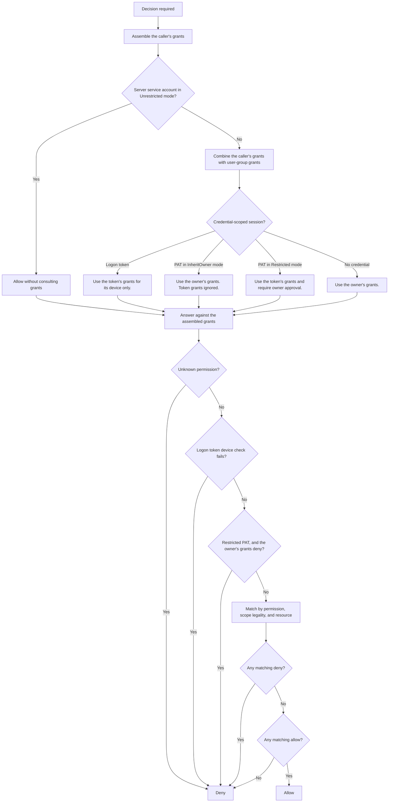

ControlR's authorization layer is a fine-grained, scope-based permission system. Each authorization decision is stored as an explicit data row that records who (principal), what (permission name), where (scope kind plus scope id), and whether (allow or deny). The server interprets these rows at request time through a deterministic algorithm.

## Core Concepts

### Permission Names

Every capability in ControlR has a unique, namespaced permission identifier following the pattern `<resource>.<action>`, such as `device.read`, `device.remote-control.connect`, or `tenant.permissions.write`. The server's permission catalog lists each name with a display name, category, description, and the scope kinds at which it may be granted. There are 67 catalog entries.

| Permission name | Capability |
|---|---|
| `server.tenants.read` | List all tenants on the server |
| `device.read` | View device details |
| `device.remote-control.connect` | Connect via remote control |
| `tenant.permissions.write` | Manage permission assignments in a tenant |

There is no `server.alerts.read` permission. The server alert banner is visible to every signed-in user. Managing the server-wide alert itself falls under `server.settings.write`.

### Permission Metadata and the Catalog

The permission catalog is readable through `GET /api/v1/permission-assignments/catalog`. Each entry returns the name, display name, category label, description, the scope kinds the permission may be granted at, and whether the permission is self-removable. The catalog is the authoritative list of valid permission names. Requests that name an unknown permission are denied, and the assignment API rejects them.

Each catalog entry records whether its allowed scopes include the Tenant scope. This marks permissions that are addressable inside one tenant. Granting such a permission at Server scope reaches every tenant, so the assignment API rejects Server-scoped allow rows of tenant-addressable permissions for every principal except server service accounts (see [Server Service Accounts](#server-service-accounts-and-the-unrestricted-mode)).

Each permission has a broadest scope in which it may be granted. Presets and account seeding use the broadest tenant-legal scope, never Server for a tenant-addressable permission, so a preset that targets a tenant never produces a cross-tenant server-scoped grant (see [Permission Presets](#permission-presets)).

### Scope Kinds

Scope kinds carry a sentinel for an unspecified value (0, which no permission allows, so a request that omits the scope kind is rejected at validation) plus six real kinds. Ordered from broadest to narrowest:

| Scope Kind | Meaning |
|------------|---------|
| **Server** | All tenants across the entire server. There is no target id and no owning tenant. |
| **Tenant** | Everything inside one tenant. The scope target is the tenant id. |
| **CustomerTenant** | One customer within a tenant. Device permissions granted here apply to that customer's devices. |
| **DeviceGroup** | One device group (a logical grouping of devices within a tenant). |
| **Device** | A single device (by id). |
| **UserGroup** | One user group. This is the resource the `user-group.assign-users` permission is granted against, meaning "you may add or remove members of this specific group". It is not how group membership grants flow. That flow is handled by the principal side (see [Principal Kinds](#principal-kinds)). |

One breadth ranking orders the scope kinds, and the server uses it in both directions. Device 0, DeviceGroup 1, UserGroup 1, CustomerTenant 2, Tenant 3, Server 4. Lower is narrower.

Picking the broadest legal scope for a grant takes the highest rank. Breaking a tie among matching allows takes the lowest, so a narrower scope wins.

### Effects

Each assignment has an effect of Allow or Deny.

- **Allow**: The principal may perform the permission at the given scope.
- **Deny**: Blocks access even when a broader allow exists.

Any matching deny defeats any matching allow, regardless of source or scope breadth. This enables exclusion patterns: grant tenant-wide access, then deny specific devices.

### Principal Kinds

Assignment rows target one of these principal kinds:

| Principal Kind | Source |
|---------------|--------|
| **User** | Individual user |
| **UserGroup** | A user group. A user's effective rules include all assignment rows scoped to groups they belong to. |
| **ServiceAccount** | Both server-scoped and tenant-scoped service accounts |
| **PersonalAccessToken** | Scope-grant rows attached to one PAT |
| **LogonToken** | Scope-grant rows attached to one logon token |

At runtime the server distinguishes four kinds of actor: user, user group, server service account, or tenant service account. A PAT or logon token session authenticates as its owning user and adds credential claims (`controlr:credential:id`, `controlr:credential:type`) that steer evaluation. The credential rows never authenticate on their own. They reshape a user principal.

A user's effective rules are the union of their direct assignments plus the assignments of every user group they belong to.

### Permission Presets

Because raw permission names are hard to reason about, ControlR ships named presets. A preset is a curated bundle of permissions, and there are seven of them.

| Preset | Count | Permissions |
|--------|-------|-------------|
| `Server Administrator` | 14 | `server.authorization-logs.read`, `server.permissions.read`, `server.permissions.write`, `server.settings.write`, `server.tenants.delete`, `server.tenants.read`, `server.tenants.write`, `server.telemetry.read`, `server.service-accounts.read`, `server.service-accounts.write`, `server.service-accounts.rotate-credentials`, `tenant.permissions.read`, `tenant.permissions.deny`, `tenant.authorization-logs.read` |
| `Tenant Administrator` | 30 | All 16 `tenant.*` permissions, `user-group.assign-users`, `device-group.assign-devices`, the four `personal-access-token.*` permissions, the three `service-account.*` permissions, the four `installer-key.*` permissions (`installer-key.self.read`, `installer-key.self.write`, `installer-key.others.read`, `installer-key.others.write`), `agent.install` |
| `Device Superuser` | 26 | All 26 `device.*` permissions (read, delete, alias, tags, desktop preview, logs, overview, the four remote-control permissions, Ctrl-Alt-Del, clipboard read/write, chat, VNC relay, the five file-system permissions, terminal, logon-token create, wake, power, agent update) |
| `Agent Installer` | 3 | `agent.install`, `installer-key.self.read`, `installer-key.self.write` |
| `Installer Key Manager` | 5 | `installer-key.self.read`, `installer-key.self.write`, `installer-key.others.read`, `installer-key.others.write`, `agent.install` |
| `Service Account Manager` | 3 | `service-account.read`, `service-account.write`, `service-account.rotate-credentials` |
| `Self Service` | 2 | `personal-access-token.self.read`, `personal-access-token.self.write` |

Presets are applied at three points, and each writes one allow row per permission at the permission's broadest tenant-legal scope. For device permissions that is Tenant scope, not Server. Server-only permissions (the `server.*` set) fall back to Server scope because no tenant-legal scope exists for them.

1. **Server bootstrap.** When the very first user is created through the self-registration path (and `DisableFirstUserSelfRegistration` is off), the seeder applies the `Server Administrator` preset to that user.
2. **New tenant creation.** When a user is created who starts a new tenant, the system applies `Tenant Administrator`, `Device Superuser`, `Agent Installer`, and `Installer Key Manager`.
3. **User baseline.** Every interactive (non-external) user receives the `Self Service` baseline. The seeder dedupes against already-granted rows.

The API can additionally apply any preset combination to a new user (the user-creation endpoint accepts preset names) or to an existing principal (the assignment management API, with an optional replace mode). User creation gates preset use by authority: `Server Administrator` requires `server.permissions.write`, presets that seed tenant-scope grants require `server.permissions.write` or `tenant.permissions.write`, and `Tenant Administrator` additionally requires `tenant.permissions.deny` unless the caller holds server writes.

An upgrade applies the same `Self Service` baseline to every non-external user already on the server, so an account that predates the current model has it too.

### Anatomy of an Authorization Row

Each explicit data row records:

- The permission name, for example `device.read`.
- The effect: Allow or Deny.
- The principal: one of User, UserGroup, ServiceAccount, PersonalAccessToken, or LogonToken, plus the principal's id.
- The scope: one of Server, Tenant, CustomerTenant, DeviceGroup, Device, or UserGroup, plus the target id. Server-scoped rows have no target id.
- The owning tenant. Server-scoped rows have no owning tenant.
- Whether the row is disabled. A disabled row grants nothing.
- Optional admin notes (max 500 chars).
- The actor who created the row, where seeded rows are stamped as "system".

Server-scoped rows carry no owning tenant. Which rows an administrator can see depends on the administrator's capabilities (see [Grant Row Visibility](#grant-row-visibility)).

### Authorization Change Logs

Every mutation to permission assignments or credential scopes creates an authorization change log entry. Each entry records the assignment values before and after the change, the actor who made it, the caller's IP address, and a correlation id. Background services write entries with no actor and no IP. The log is readable through its own API and provides an auditable trail for compliance and troubleshooting.

## The Evaluation Algorithm

When the server must decide whether a request is allowed, it evaluates the permission against the requested resource. It assembles the caller's grants once per request, then answers each question against that assembly.

### Stage 1: Assembling the Caller's Grants

The server first assembles the grants it will answer from. For most callers that set is the caller's own grants plus the grants of every user group the caller belongs to, and it is then narrowed by the caller's tenant and session type.

**Server service accounts.** When the caller is a server service account, the server checks the account's access mode. A value of Unrestricted means every permission is allowed without consulting any grant. See [Server Service Accounts](#server-service-accounts-and-the-unrestricted-mode).

**Owning grants.** The caller's own grants are combined with the grants of every user group the caller belongs to. Each grant is distinguished by its source (direct, user group, personal access token, or logon token), because when grants conflict the source decides which one wins. A caller with no tenant that is not a server service account has no grants.

Two restrictions narrow every set for a caller bound to a tenant:

- **Tenant ownership.** A grant is honored only when it carries no owning tenant (server-wide) or its owning tenant is the caller's current tenant. Grants owned by a former tenant, for example after a cross-tenant move, are ignored.
- **Server-scope overreach.** A tenant-bound caller must not hold a Server-scope *allow* of a tenant-addressable permission, because that grant would reach outside the tenant. Those allows are ignored. Denies at Server scope are kept, because dropping a deny would widen access.

**Logon-token sessions.** For a session carrying a logon-token credential, the server answers only from the token's own grants, and only grants scoped to the token's bound device are honored. A token session whose claims carry no device scope has no grants and authorizes nothing.

**Personal access tokens.** For a session carrying a personal access token, the server checks the token's permission mode. InheritOwner means the server answers from the owner's grants exactly and ignores the token's own grants. The default mode, Restricted, answers from the token's own grants and additionally requires the owner's approval as described below.

### Stage 2: Limits on Credential Sessions

**Logon tokens.** The server enforces the device boundary again when the request is evaluated. The session must carry a device scope and a credential id. A request against a different device is denied before any grant is considered. A token with no surviving grants can do nothing. Its grants replace, rather than combine with, the creator's own grants. Escalation is prevented at creation time (see [Logon Tokens](#logon-tokens)).

**Personal access tokens.** In Restricted mode a request needs two independent approvals. The owner's grants must allow the permission against the requested resource, and one of the token's own grants must match that resource. If the owner check fails, the request is denied. A token with no grants authorizes nothing. The owner check runs when the request is evaluated, and the same authority check runs when the token's grants are written, so out-of-bounds grants are normally rejected before they are stored (see [Managing Assignments](#managing-assignments)).

### Stage 3: Matching Grants to the Request

The server narrows the assembled grants to the ones that match the request:

1. The permission name must match exactly.
2. **Scope legality.** An *allow* grant is ignored when the permission's catalog does not list the grant's scope kind among its allowed scopes. A wrong-scope allow must not grant anything, so it fails closed. *Deny* grants are kept at any scope, because honoring a deny is never unsafe.
3. **Resource match**:
   - A Server-scope grant matches any resource.
   - A Tenant-scope grant matches when its target id equals the resource's tenant id.
   - A grant whose scope kind equals the resource's kind matches when its target id equals the resource's id.
   - A DeviceGroup grant matches a Device resource when the device belongs to that group.
   - A CustomerTenant grant matches a Device resource when the device's customer id equals the grant's target id.

Among the grants that match, any deny defeats every allow. When several allows remain, the server picks the winner by source in this order, lowest first: PAT grant 0, logon-token grant 1, direct grant 2, user-group grant 3. It then breaks ties by scope specificity, narrowest first, so credential grants beat direct grants, direct grants beat group grants, and narrower scopes beat broader ones. Zero matching grants is a default deny. The result carries the allow-or-deny outcome, the source and scope that decided it, or the reason it was denied.

## Server Service Accounts and the Unrestricted Mode

A server service account's bypass is a persisted choice, not an inference. The service-account record carries an access-mode setting with two values:

- **Restricted** (the default, and the mode for every tenant service account): the account evaluates its assignment rows normally. Zero rows deny everything.
- **Unrestricted**: the account passes every permission check with full cross-tenant reach.

The mode is chosen when the account is created. Selecting Unrestricted requires the creator to hold `server.permissions.write` evaluated at Server scope. The current management API and UI expose only name, description, and enable/disable, so the mode is not editable after creation. The evaluation never inspects assignment rows to decide the bypass, so attaching or removing rows cannot silently flip an account between modes.

Because assigning permissions to a server service account could shadow its cross-tenant reach, the assignment management layer requires the actor to hold `server.permissions.write` before creating, updating, deleting, or replacing assignments that target a server-kind service account, whatever the rows' own scope. The UI refuses to open the permission panel for an Unrestricted account.

## Personal Access Tokens

PATs authenticate as their owning user, plus credential claims. The token record carries a permission-mode setting with two values:

- **Restricted** (the default): the token evaluates only its own scope rows. Zero rows deny everything. Each request additionally requires the owner's effective permissions to cover it, checked at evaluation time and enforced at creation time, so a token can never outlive its owner's rights.
- **InheritOwner**: the token evaluates exactly as its owning user. Scope rows are not consulted.

A background sweep runs every 15 minutes and deletes allow rows that the owner no longer covers (for example after the owner lost a permission). The rows were already inert at evaluation time, so this is storage hygiene rather than a security boundary, and each trim is recorded in the authorization change log. Deny rows are never trimmed. Denies are deliberately allowed to exceed the owner's reach.

## Logon Tokens

A logon token is a single-use, device-bound credential. It holds a hashed token with a display prefix, the bound device, the creating user, an expiry, a consumed flag, and optional allowed desktop session ids. Creation is gated by `device.logon-token.create` and by a grantor check: every requested scope is evaluated against the creator's effective permissions before anything is written.

- Without explicit scopes the token is created with two baseline grants, Device-scoped `device.read` and `device.overview.read` on its device. That baseline is a viewer credential. Remote control is deliberately absent from it, so a scopeless token cannot drive the machine. Control has to be asked for by name in the explicit list.
- With explicit scopes the token is created without the baseline and the explicit list becomes its full permission set. The scopes must be Device-scoped, must target the token's own device, and `device.read` is unioned in automatically.

Redeeming a token consumes it and signs the redeemer in as the token's creating user with claims that pin the session: `controlr:credential:type` = `LogonToken`, `controlr:credential:id`, and a device-session-scope claim. From there the server answers from the token's device-scoped grants instead of the user's own grants, so the session is bounded by the token, not by the creator's breadth.

One further gate applies when the session is opened. A logon-token session may act only on its bound device, and when the token carried an allowed-session list the requested system session id must be in it. Other principals pass unconditionally and are governed by ordinary permissions instead.

## Policies and Claims

### Server-Side Policies

A policy pairs a friendly name with a permission and a resource scope. Most policies target the whole tenant or the whole server. The device-group assignment policy targets a device group, and the user-group assignment policy targets a user group. Each policy is checked as a permission requirement at its scope.

- **Policy-to-permission definitions**: each policy name maps to a permission name and the scope kind the policy acts on. Most entries are Tenant or Server. The device-group assignment policy sits at DeviceGroup and the user-group assignment policy at UserGroup.
- **Device-resource policies**: one named policy per device permission (read, remote-control connect, and so on), each checked at Device scope.

Every policy check reduces to one permission name checked against one resource, and all policies use the same single decision path.

The server checks a request in one pass:

1. The server rebuilds who the caller is from their sign-in claims. Missing or invalid claims deny.
2. The server resolves the resource. A device is matched with its tenant, customer, and group memberships. A tenant-scoped policy with no id resolves to the caller's tenant. Other scoped kinds resolve the same way, and the check fails closed when the target does not exist in the caller's tenant.
3. The server decides the permission against that resource, and the request passes or fails. Exceptions fail closed.

Device checks run through the web framework's authorization service, so a page or endpoint that demands a device permission is enforced by the normal request pipeline.

### Client-Side Policy-Grant Claims (Blazor)

The browser never enforces permissions on its own. It only shows or hides parts of the UI using claims:

1. When the Blazor app starts, it asks the server for the list of policy names the caller holds. That list covers every policy scoped to the whole tenant or server.
2. Each allowed policy name is attached as a claim of type `controlr:client-policy`.
3. The client marks pages with the same policy names and shows them when that claim is present. A page marked with the server-tenants-read policy shows when that claim is present.

Policies tied to a specific device group, user group, or device are never sent to the browser, because a claim cannot answer a per-resource question. Device access decisions always go through the server.

The list uses the *user's* identity, not the session's narrower credential scope. A page shown this way reflects what the owning user can do and does not shrink for a PAT session with a narrower scope. Access control always happens server-side. The claims exist only for UI visibility.

## Device Enumeration (Which Devices a Caller Sees)

When the server lists devices, it evaluates the caller's `device.read` grants once and uses the result to limit the returned devices, instead of checking each device one by one.

The result describes what the caller may see: a tenant boundary, whether every device is visible, id lists to include or exclude for tenants, device groups, customers, and devices, and an optional constraint that a Restricted personal access token must also satisfy. Tags are device metadata and carry no authorization role anywhere in the permission system. Tag management is gated by `device.tags.write` and `tenant.tags.write`. Reading a device already returns its tags under `device.read`, with no separate tags permission.

Resolution order:

1. A logon-token session missing its credential or device-scope claims sees no devices.
2. A caller the server cannot identify sees no devices.
3. A server service account in Unrestricted mode sees every device. Callers do not treat this case specially.
4. A caller with no matching `device.read` grants sees no devices.
5. A logon-token session may see only its bound device, and only when the token grants it. A deny, or no allow, hides that device too.
6. Otherwise allows add devices to the visible set, and a Server-scope allow makes every device visible. Denies remove devices from it. A Server-scope deny hides every tenant's devices, so the listing returns no devices. A caller with no allows sees no devices.
7. A Restricted personal access token is also limited to what its owner may see. The server builds the same visible set from the owner's `device.read` grants and lets the token see only devices present in both, matching the rule that a token cannot exceed its owner.

The returned list contains every device the caller's grants include within the tenant, reached by server-wide access, tenant, direct device id, customer, or group membership, minus whatever the caller's denies exclude.

For flows like agent installation and tag assignment, the server also answers per-device questions using the named permission against that device, so device-scoped denies are honored even when a broader tenant right exists.

## Managing Assignments

The assignment management API implements the admin operations: create/update/delete single or batch assignments, apply presets, and replace a principal's assignments for the scope kinds being sent. Every write emits an authorization change log entry, duplicates are rejected with a conflict, and replaces are applied atomically for the principal. Key guardrails:

- **Write authority**: managing tenant-scoped rows requires `tenant.permissions.write`. Managing server-scoped rows requires `server.permissions.write`. Creating or editing a row whose effect is Deny additionally requires `tenant.permissions.deny`, at any target scope including Server.
- **Delegated administration**: the write check tests only the management permission, not whether the actor holds the permission being granted. A `tenant.permissions.write` holder can grant any tenant-scoped permission to anyone, including themselves, so that permission is de facto full tenant admin. This is intentional (see [Delegated Administration](#delegated-administration-for-direct-grants)). User creation narrows the rule for the `Tenant Administrator` preset, which also demands `tenant.permissions.deny`, so a `tenant.users.write` holder cannot mint a new permission manager.
- **Credential principals are grantor-bounded**: rows written to a PAT or logon token principal are validated against the owner's effective permissions at write time. Each requested scope is evaluated against the owner, and Server-scope grants of tenant-addressable permissions to a credential are rejected. Logon-token rows must be Device-scoped to the token's own device. Deny-effect credential rows skip the owner-authority check because a deny confers nothing.
- **Scope validation**: the permission must exist, the requested scope kind must be in the permission's allowed scopes, a target id is required for Device/DeviceGroup/CustomerTenant/UserGroup and forbidden at Server scope, the target must live in the acting tenant, and Server-scoped allows of tenant-addressable permissions are accepted only when the target principal is a server service account.
- **Tenant isolation**: row visibility gates which rows an actor can see. Tenant-owned rows are visible only to the owning tenant. Server-scoped rows (no owning tenant) additionally require the actor to hold `server.permissions.read` or `server.permissions.write`.
- **Self-protection**: see the [Self-Removable Guard](#self-removable-guard).

Integrators can query a principal's effective permissions through the V1 endpoint `GET /api/v1/effective-permissions/{principalId}`, which answers "may principal P hold permission X at scope S".

## Upgrading From an Earlier Server

An upgrade converts each role membership into explicit allow grants. Each grant lands at the permission's broadest legal scope, so `server.*` permissions are stored at Server scope with no owning tenant and everything else at Tenant scope inside the user's own tenant. The resulting grant set is a superset of the matching preset, so an upgraded account keeps the access it had. The role data the conversion reads is deleted by the same upgrade, so it runs once per database, and a fresh install has nothing to convert.

## Object Model

| Concept | Purpose |
|---------|---------|
| **Customer** | A customer within a tenant, with a unique name per tenant. Devices optionally belong to customers. |
| **Device group** | A logical grouping of devices within a tenant, with a unique name per tenant. |
| **User group** | A logical grouping of users within a tenant. Assignments targeting the group apply to members' effective rules. |
| **Logon token** | A single-use, device-bound credential with expiry and optional desktop-session restrictions. Its grants live as explicit assignment rows. |

## Design Decisions

### Delegated Administration for Direct Grants

Direct assignment writes are checked against the management permissions only (`tenant.permissions.write` / `server.permissions.write`, plus `tenant.permissions.deny` for deny rows). The system does not require the actor to hold the permission being granted, so a tenant permission writer can grant any tenant-scoped permission, including to themselves. This is an accepted privilege-escalation trade-off. The management permissions are guarded against self-removal, the catalog's scope whitelist plus the server-scope rejection keep a tenant writer from minting Server-scoped reach for tenant-addressable permissions, and every change is audit-logged. Credential principals (PAT and logon token) are the exception: their rows are bounded by the grantor's effective permissions at write time and, for Restricted PATs, re-checked at evaluation time, so a credential can never exceed its creator.

### Grant Row Visibility

Server-scoped rows carry no owning tenant. Which rows an administrator sees depends on capability. Server-scoped rows are shown only to holders of `server.permissions.read` or `server.permissions.write`.

### Persisted Unrestricted Mode for Server Service Accounts

An early design granted the bypass whenever a server service account had zero assignment rows, which meant attaching a single row collapsed the account and deleting it later could silently restore a bypass the operator believed they had removed. The shipped model stores the decision on the account, chosen at creation behind a `server.permissions.write` check, and evaluation never infers it from row counts. Restricted accounts, including ones whose rows were all deleted, fail closed.

### Self-Removable Guard

Three permissions are guarded against self-removal in the catalog: `server.permissions.write`, `tenant.permissions.write`, and `tenant.permissions.deny`. When an actor changes their **own** direct assignments, the assignment manager rebuilds the actor's rule set before and after the change and blocks the write if the change would flip any guarded permission from allowed to denied. The check guards only the actor's own principal, so another authorized holder may still revoke these grants.

### Fail-Closed Everywhere

Unknown permission names deny. Missing principal claims deny. A resource that cannot be resolved denies. An exception during evaluation denies. A Restricted credential with zero scope rows authorizes nothing. There is no fallback to a broader grant and no silent default-allow.

### Deny Overrides Allow

Any matching deny beats any matching allow, regardless of source or scope breadth. This enables exclusion patterns: grant tenant-wide `device.read` to a group, then add a device-scoped deny for a critical device. The server honors the deny even when it is narrower than the allow, and deny rows survive both scope-legality filtering and the server-overreach drop.